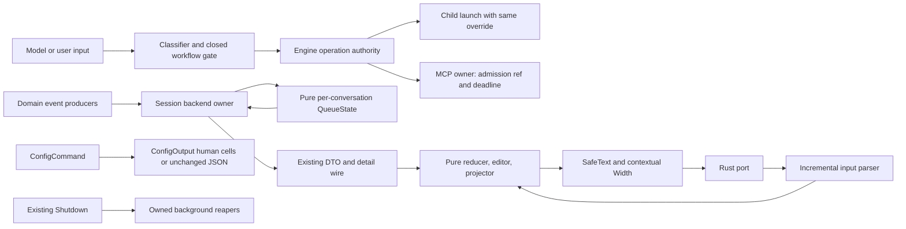

# Requirements

## Introduction

This is a proposed remediation specification for the ncode 0.2.2 application at
review baseline `fb758e7e`, dated 2026-10-11. It turns the confirmed,
high-confidence findings in the [whole-app review](../docs/research/2026-10-11-whole-app-review.md)
into implementation-ready work without redesigning the product or claiming
that any criterion already passes. The work is for ncode users who need
fail-closed tool approvals, reliable local-session behavior, safe terminal
output, and bounded background work.

The scope is deliberately limited to the 15 finding groups below. Every
criterion is a proposed future contract. The detailed audit remains in the
review report; the stable finding IDs here are the join keys.

## Requirements

### Requirement 1: Fail closed for quoted shell flags (SEC-01)
**Review:** [SEC-01](../docs/research/2026-10-11-whole-app-review.md#sec-01)
**User Story:** As a project owner, I want shell safety classification to
understand quoted and escaped option tokens, so that a command cannot gain
automatic approval by spelling a write or execution option in a form the
classifier does not recognize.

#### Acceptance Criteria
1.1 WHEN `SwarmCode.Domain.Tools.CommandSafety.classify/1` receives a quoted or
escaped option that enables output, preprocessing, compression, in-place
editing, or another executable/write behavior, THEN it SHALL return
`:normal` or `:dangerous`, never `:safe`.
1.2 WHEN a command contains syntax that the bounded normalizer cannot classify
without guessing, including input redirection whose confinement is not proven,
THEN it SHALL never return `:safe` (`:normal` unless existing dangerous classification wins); it SHALL not execute a shell or add a parser dependency.
1.3 WHEN the command is a genuinely safe quoted filename such as
`cat "lib/a b.ex"` and the normalized operand remains inside the project, THEN
it SHALL retain `:safe`; ordinary safe commands and their existing family
behavior SHALL remain unchanged.

### Requirement 2: Close the workflow smoke-check value language (SEC-02/SEC-03)
**Review:** [SEC-02](../docs/research/2026-10-11-whole-app-review.md#sec-02) · [SEC-03](../docs/research/2026-10-11-whole-app-review.md#sec-03)
**User Story:** As a project owner, I want model-authored workflows checked
against a closed value language, so that a smoke check cannot forge structs,
dispatch through a protocol, or use dynamic decoder options to escape the
workflow policy.

#### Acceptance Criteria
2.1 WHEN `SwarmCode.Domain.Workflows.Smoke.validate_ast/1` sees a forged
`%{__struct__: ...}` map, a literal struct outside the explicitly closed
allowed data set, `Enum.into/2` or `/3` with a nonliteral collectable target, or a module atom used as data, THEN it SHALL return a source-line error containing
`is not allowed in a workflow`.
2.2 WHEN a workflow calls `Jason.decode/2` or `Jason.decode!/2` with options,
THEN the checker SHALL allow only literal `[]` or `[keys: :strings]`;
dynamic option variables, `keys: :atoms`, and unknown options SHALL be
rejected with a source-line error.
2.3 WHEN the built-in workflow corpus is smoke checked, THEN all current built-ins SHALL pass AST admission and retain their canned smoke result shape and no OS sandbox or new
runtime service SHALL be required by this remediation.

### Requirement 3: Preserve approval overrides across child launches (SEC-04)
**Review:** [SEC-04](../docs/research/2026-10-11-whole-app-review.md#sec-04)
**User Story:** As a headless-session user, I want a run-level approval choice
to apply to the agents and workflows it starts, so that a read-only parent
cannot silently create a full-access child and an explicit valid mode is not
lost.

#### Acceptance Criteria
3.1 WHEN an `AgentServer` context has `approval_override` set to
`"read_only"`, `"auto"`, or `"full_access"` and it invokes `start_swarm`,
THEN the child call SHALL pass `approval_mode: override` to
`SwarmCode.Domain.Engine.start_swarm/3`.
3.2 WHEN a workflow tool launches a workflow from a context with an approval
override, THEN `SwarmCode.Domain.Workflows.launch/1` SHALL receive
`approval_mode: override`; the workflow run's operation context SHALL retain
that value.
3.3 WHEN the context override is `nil`, THEN child launches SHALL preserve the
project approval behavior exactly; invalid explicit modes SHALL continue to
return the existing invalid-mode refusal before any child rows are written.

### Requirement 4: Bound queued MCP calls by owner and deadline (SEC-05)
**Review:** [SEC-05](../docs/research/2026-10-11-whole-app-review.md#sec-05)
**User Story:** As a user running an MCP tool, I want a queued call to stop
when its caller or deadline is gone, so that stale work cannot execute later
against a newly ready server.

#### Acceptance Criteria
4.1 WHEN `SwarmCode.Domain.MCP.Client` admits a call into `waiting` or
`http_queue`, THEN it SHALL store the caller identity/monitor and one absolute
monotonic deadline derived from the original timeout.
4.2 WHEN the owner dies, the deadline expires, the client reconnects, or the
client terminates, THEN the queued item SHALL be removed or answered once with
the existing error vocabulary and SHALL not be dispatched.
4.3 WHEN a queued item is dispatched or retried after handshake/session
recovery, THEN it SHALL reuse its original deadline and owner monitor; no
second monitor, timer, or caller reply SHALL be created for the same admission.
4.4 WHEN a local fake MCP transport is used, THEN every call crossing the
queue-to-dispatch boundary SHALL have a live owner and a positive remaining
deadline; no remote credential or external API is needed.

### Requirement 5: Use a live clock for plain-session requests (CLI-01)
**Review:** [CLI-01](../docs/research/2026-10-11-whole-app-review.md#cli-01)
**User Story:** As a pipe or CI user, I want plain-mode requests to receive
fresh deadlines, so that a session open longer than 30 seconds does not make
new commands, detail pages, or completion queries expire immediately.

#### Acceptance Criteria
5.1 WHEN `SwarmCodeCLI.Plain.Session` creates an outward resync, completion,
detail, or command request, THEN its owner SHALL supply a fresh
`System.system_time(:millisecond)` value for that request and the wall-clock
request deadline SHALL equal `now_ms + 30_000`; the read SHALL remain outside
reducers and presenters.
5.2 WHEN an adapter-boundary fixture independently steps its wall clock and
monotonic clock, THEN a wall-clock step SHALL change only newly stamped request
deadlines while the adapter's monotonic transport timeout SHALL continue from
its own monotonic value; send, detail, control, completion, and resync paths
SHALL use the same wall-clock contract.
5.3 WHEN the one-shot presenter is used, THEN it SHALL retain its independent
behavior; this remediation SHALL not change its timeout contract.

### Requirement 6: Sanitize human-readable config output centrally (CLI-02)
**Review:** [CLI-02](../docs/research/2026-10-11-whole-app-review.md#cli-02)
**User Story:** As a user importing or inspecting settings, I want terminal
control bytes rendered inert, so that a malicious key or value cannot rewrite
my terminal while machine-readable JSON retains its semantic value.

#### Acceptance Criteria
6.1 WHEN any user-controlled key, value, path, record field, error, preview
row, or summary reaches a human-readable `ncode config` output sink, THEN it
SHALL pass through `SwarmCodeCLI.UI.SafeText.external/2` (or an equivalent
central wrapper) with controls such as ESC, BEL, CR, and LF rendered inert;
the output SHALL contain no raw byte `0x1b`, `0x07`, or carriage return.
6.2 WHEN `--json` is selected, THEN JSON encoding SHALL remain machine
semantic and valid; the human display sanitizer SHALL not mutate persisted
values, command attributes, or secret values.
6.3 WHEN a secret field appears in a human-readable result, THEN only the
existing mask (`set` plus optional four-character hint) SHALL be shown, never
the secret bytes.

### Requirement 7: Make config record reads and expectations type-correct (CLI-03/CLI-04/CLI-05)
**Review:** [CLI-03](../docs/research/2026-10-11-whole-app-review.md#cli-03) · [CLI-04](../docs/research/2026-10-11-whole-app-review.md#cli-04) · [CLI-05](../docs/research/2026-10-11-whole-app-review.md#cli-05)
**User Story:** As a script author, I want `ncode config record` to compare
the same complete masked record that it displays, so that MCP secrets,
provider model lists, and expected values do not produce false conflicts.

#### Acceptance Criteria
7.1 WHEN `ncode config record get provider:NAME` is called, THEN the displayed
record SHALL include the provider's stored `models` list and its masked
`api_key`; a provider with no models SHALL display `models: []`, not `nil`.
7.2 WHEN a secret command reads its current expectation, THEN provider/search comparison SHALL use the masked `api_key`; MCP `env.NAME` or `headers.NAME` SHALL use that selected entry’s `{set, hint}` mask and its exact `env:NAME` or `header:NAME` secret slot, including an unset mask for absent entries.
7.3 WHEN `--expect` has an invalid integer, enum, list, or record-field value,
THEN for ref `provider:DeepSeek.models` the command SHALL print exactly
`ncode: invalid --expect value for provider:DeepSeek.models. Run 'ncode config help'.`
to stderr; another ref changes only that reference segment. The command SHALL exit `2` without raising or writing a row.
7.4 WHEN an expectation matches, conflicts, or the database lease is held,
THEN existing success `0`, changed-elsewhere `4`, and startup-refused `3`
semantics and their existing successful output SHALL remain unchanged.

### Requirement 8: Preserve paste payloads and expand them once (TUI-01/02/03)
**Review:** [TUI-01](../docs/research/2026-10-11-whole-app-review.md#tui-01) · [TUI-02](../docs/research/2026-10-11-whole-app-review.md#tui-02) · [TUI-03](../docs/research/2026-10-11-whole-app-review.md#tui-03)
**User Story:** As a TUI user, I want collapsed pastes to survive undo,
select-all, delete, and external editing, so that a payload is never silently
lost or recursively rewritten.

#### Acceptance Criteria
8.1 WHEN a collapsed paste is deleted by Backspace, Delete, select-all, or an
external-editor replacement, THEN its payload SHALL remain available to the
editor history until the history record that references it is discarded; an
undo SHALL restore the placeholder and expand to the original bytes.
8.2 WHEN the draft already has 64 paste references retained across current text, undo/redo, and the vim register, THEN the new collapsed paste SHALL
be refused atomically with the exact notice
`Paste limit reached; send or remove an existing paste first.`; the draft,
cursor, and undo/redo history SHALL remain unchanged.
8.3 WHEN send, steer, or an external-editor path expands a draft, THEN it
SHALL count expanded bytes without materializing payload copies and stop on the
first contribution exceeding `262_144` bytes. Only a count within that ceiling
may be materialized in one pass over original markers, expanding every original
occurrence but never interpreting inserted payload bytes. An over-bound attempt
SHALL preserve the draft, history, cursor and pending-request state, emit no
send/steer/editor-launch effect, and show exactly `The message is over 256 KiB.`.
8.4 WHEN a user intentionally types or edits a literal placeholder-shaped
string, THEN the existing verbatim-placeholder semantics SHALL apply
consistently and the behavior SHALL be documented in `Draft.Pastes`.

### Requirement 9: Make contextual width accounting additive-safe (TUI-04)
**Review:** [TUI-04](../docs/research/2026-10-11-whole-app-review.md#tui-04)
**User Story:** As a multilingual TUI user, I want shaping-sensitive sequences
to wrap as units, so that lam-alef and existing Unicode joining cases do not
split or overflow a row under either ambiguous-width policy.

#### Acceptance Criteria
9.1 WHEN `Width.cells/2`, `Width.take_cells/3`, and `Width.wrap/3` process
contextual sequences such as lam-alef, Hebrew joining, Tifinagh, Lisu, and
existing Unicode 17 vectors, THEN the returned prefix cell count SHALL equal
the count of that returned prefix under `Width.cells/2`; no result may rely on
naive grapheme-width addition.
9.2 WHEN a wrap width is `N`, THEN every non-forced line SHALL be at most `N`
cells under the selected policy and a contextual unit SHALL not be split
between lines; a unit wider than `N` SHALL be emitted as one bounded line.
9.3 WHEN tab expansion is performed by `SafeText` with tab width `8`, THEN
the next column SHALL advance to the next multiple of 8 from the current
column, including after contextual-width text, without exceeding the escaped
field bound.
9.4 WHEN the input is long, the traversal SHALL remain linear in the number of
codepoints/graphemes consumed for the requested prefix; it SHALL not restore
quadratic prefix remeasurement.

### Requirement 10: Do not classify parser-state bursts as scroll (TUI-06)
**Review:** [TUI-06](../docs/research/2026-10-11-whole-app-review.md#tui-06)
**User Story:** As a terminal user, I want bracketed paste contents preserved,
so that repeated arrow bytes inside a split paste are not mistaken for wheel
scroll.

#### Acceptance Criteria
10.1 WHEN the terminal owner receives a burst, THEN `arrow_burst/1` SHALL be
consulted only while `InputParser` is in its ground state and no partial
escape, UTF-8, control-string, sequence, or paste state is retained.
10.2 WHEN a bracketed paste containing repeated `CSI A` or `CSI B` bytes is
split at any byte boundary, THEN the parser/session SHALL emit one paste with
the original bytes and SHALL emit no `Event::Scroll`.
10.3 WHEN a ground-state burst contains two or more identical arrows, THEN
existing scroll direction/count behavior SHALL remain unchanged; a single
arrow or mixed burst SHALL remain ordinary input.

### Requirement 11: Drain queues for every active conversation (LIFE-01)
**Review:** [LIFE-01](../docs/research/2026-10-11-whole-app-review.md#life-01)
**User Story:** As a user navigating between conversations, I want each
conversation's queued prompt to wait behind its own run, so that leaving a view
does not strand work or send conversation A's prompt into B.

#### Acceptance Criteria
11.1 WHEN a backend owns active conversations with queued prompts, THEN it
SHALL maintain per-conversation queue monitors/generations and drain each
conversation only after that conversation's live turns finish.
11.2 WHEN the user switches views, THEN queue ownership SHALL continue without
cancelling the old conversation; its next queued prompt SHALL start exactly
once and the newly selected conversation SHALL remain unchanged.
11.3 WHEN a monitored run sends a stale `DOWN` or a retry is scheduled, THEN
generation checks SHALL prevent duplicate starts and stale messages SHALL be
ignored; shutdown SHALL remove each monitor once.

### Requirement 12: Join background reapers before shutdown (LIFE-02)
**Review:** [LIFE-02](../docs/research/2026-10-11-whole-app-review.md#life-02)
**User Story:** As a user quitting ncode, I want every background process
reaper joined within the existing shutdown budget, so that a TERM-ignoring
fixture cannot survive the session or be killed through a recycled PID.

#### Acceptance Criteria
12.1 WHEN an asynchronous kill is admitted, THEN its task/monitor and the exact current row identity SHALL remain owned until completion, even when its visible row is removed.
12.2 WHEN `SwarmCode.Daemon.Shutdown.run/1` reaches
`:reap_background_commands`, THEN it SHALL request all current reapers,
join asynchronous reapers within the existing 15,000 ms cleanup budget before application halt; the existing `reaped` result field SHALL retain its documented survivor-count meaning.
12.3 WHEN a reaper completes late or a janitor reports an exited shell, THEN the completion SHALL not delete a newer replacement row or authorize an additional integer-PID kill; existing janitor/OSProcess ownership semantics SHALL not be weakened.

### Requirement 13: Deliver rate-limit and run-total events (IPC-01/02)
**Review:** [IPC-01](../docs/research/2026-10-11-whole-app-review.md#ipc-01) · [IPC-02](../docs/research/2026-10-11-whole-app-review.md#ipc-02)
**User Story:** As a TUI user, I want model rate limits and run usage to
update while a turn streams, so that the status and cost displays do not
remain stale until a full reload.

#### Acceptance Criteria
13.1 WHEN `LLM.HTTP.capture_rate_limit/2` broadcasts on
`SwarmCode.Domain.LLM.rate_limit_topic/0`, THEN the persisted backend SHALL be
subscribed to that exact topic and SHALL coalesce the changed provider row into
the next shell-watch refresh.
13.2 WHEN `RunServer` broadcasts `{:run_totals, run_id, totals}`, THEN the
backend SHALL refresh that run's totals and publish one projection update;
ordinary node patches and full run updates SHALL not double-count usage.
13.3 WHEN a late `Writes.add_run_usage/4` update arrives after a run has
finished, THEN the next projection SHALL show the new tokens/cost exactly once;
the producer and consumer tests SHALL use real broadcasts, not direct mailbox
injection.

### Requirement 14: Resolve live tool detail references (IPC-03)
**Review:** [IPC-03](../docs/research/2026-10-11-whole-app-review.md#ipc-03)
**User Story:** As a live-session user, I want to open the full output of a
tool row, so that the live presenter has the same bounded detail behavior as
saved sessions.

#### Acceptance Criteria
14.1 WHEN a live tool node carries a `detail_ref`, THEN
`SwarmCode.Daemon.Service.LiveBackend` SHALL resolve its exact tool name and
newline-separated output for the requested offset.
14.2 WHEN live tool output exceeds 2,048 bytes, THEN the first detail response
shall use the existing `detail_ref`/`next_offset` bounds and cursor shape, and
successive pages SHALL preserve UTF-8 boundaries.
14.3 WHEN the detail ID is missing, out of scope, or malformed, THEN the
existing invalid-request response and error shape SHALL be returned unchanged.

### Requirement 15: Bound workflow host reads without whole-file loading (PERF-01)
**Review:** [PERF-01](../docs/research/2026-10-11-whole-app-review.md#perf-01)
**User Story:** As a project owner, I want workflow smoke checks to read only
the bounded file prefix they can return, so that a huge file cannot consume
unbounded memory before the 200,000-character cap is applied.

#### Acceptance Criteria
15.1 WHEN `SwarmCode.Domain.Workflows.Host.run/3` handles `:read_file`, THEN it
SHALL reject non-regular files, read bounded UTF-8 chunks, and stop at the
existing 200,000-grapheme return cap, with a new 5,000,000-byte file admission/read ceiling without calling `File.read/1` for the
whole file.
15.2 WHEN a file ends or the cap falls inside a multibyte UTF-8 sequence, THEN
the returned text SHALL be valid UTF-8 and SHALL preserve all complete
characters before the cap.
15.3 WHEN a path is outside the project root or a file cannot be opened, THEN
the existing confinement/error text SHALL be preserved; no benchmark-specific
SLA or new dependency is introduced.

## Non-Functional Requirements

- Performance: Queue admission, width traversal, host reads, and paste
  expansion remain bounded by the existing limits; no new remote calls,
  unbounded process mailbox, or whole-file allocation is allowed.
- Security: Shell classification, workflow validation, terminal output, MCP
  ownership, and configuration secrets fail closed. This work does not claim
  that in-VM workflow evaluation is a formal sandbox.
- Reliability: Every request has one owner, one deadline, and at most one
  reply; every shutdown-owned task is joined or explicitly reported within
  existing budgets.
- Usability: Existing successful text, JSON semantics, approval modes, exit
  codes, cursor shapes, and safe quoted filenames remain compatible except for
  the exact new refusal/notice strings specified above.
- Tooling: No new dependency, OTP service, database migration, desktop edit,
  provider call, or public release artifact is part of this scope.

## Out of Scope

- Guarded VACUUM maintenance, crash-recovery backup/initialization ownership,
  secret-revision CAS, broker plaintext coordinated desktop changes, URL
  userinfo policy, effort-after-compact, the slow-terminal hard 60-second and
  restoration timing trade-offs, companion functionality/SSE bounds, installer
  atomic switching, parent-directory fsync, provenance multi-file recovery,
  and the lifetime live-4096 cap. These remain recommendations in the review
  report, not dropped findings.
- A new OS sandbox for workflow evaluation. The closed DSL is a safer static
  boundary; formal isolation is a future architecture decision.
- Rewriting the architecture, adding a service, adding a framework, changing
  the desktop app, changing the shared schema, or requiring real provider
  credentials.

# Design

## Overview

This is documentation-only planning; no implementation is authorized by creating this file. The design narrows the confirmed defects, not the whole audit, and preserves the three-app boundary, session shutdown semantics and shared database contract. The template is `/Users/zaali/.spec.md`; `~/.spec.d` is treated as a filename typo. Recommendations not selected here remain in the [review](../docs/research/2026-10-11-whole-app-review.md).

Chosen approach: local fixes at existing authority/ownership boundaries, plus two small helpers (`ConfigOutput`, pure `QueueState`). Rejected alternatives are an app rewrite/new coordination service (unnecessary scope) and a workflow OS-sandbox migration (requires an independent architecture decision). Preserve renderer purity, bounded task ownership, centralized inert output, per-conversation rather than per-view liveness, and producer/consumer consistency. Extract by responsibility when needed, not by line count; introduce no framework.

## Code Reuse Analysis

Paths below are repository-relative to `/Users/zaali/dev/swarm-code-cli`; existing signatures and integration quotes were inspected at `fb758e7e`. New interfaces are explicitly labeled below.

| Boundary | Verified reuse and baseline integration quote |
| --- | --- |
| Shell | `apps/swarm_code_daemon/lib/swarm_code/domain/tools/command_safety.ex:450-463`: `words = Enum.map(rest, &unquote_word/1)` but `system_argv0?(argv0) and safe?(name, rest, text) -> :safe`. Reuse `classify/1`, `prefix/1`, dangerous checks and `Engine.Policy.decide/3`; fix the safe arm’s preserved quotes. |
| Workflows | `apps/swarm_code_daemon/lib/swarm_code/domain/workflows/smoke.ex:324-340` only checks literal options; `allowed_remote?/2` admits entire Enum/Jason modules. Reuse `validate_ast/1`, `errors/1`, `check/3`; `tools/workflow_tools.ex` labels WorkflowSmokeCheck `permission(_args), do: :read`, so check before `workflows/runner.ex` reaches `Code.eval_quoted`. |
| Approval | `apps/swarm_code_daemon/lib/swarm_code/domain/engine/agent_server.ex:1077-1094`: `approval_override: Map.get(state, :approval_override)` already reaches ctx. `tools/start_swarm.ex:96-109` calls `Engine.start_swarm(conversation, task, opts)` without it. `tools/workflow_tools.ex:358-394` builds base then `Workflows.launch(attrs)`. Engine.start_swarm/3 and Workflows.launch/1 already validate/use approval_mode; leave them untouched. |
| MCP | `apps/swarm_code_daemon/lib/swarm_code/domain/mcp/client.ex:473-482`: `waiting: :queue.in({from, "tools/call", params, timeout, true}, state.waiting)`; HTTP queue has the same missing owner/deadline. Reuse its task generation, `monitor_caller/1`, `cancel_at_server/3`, `drain_waiting/1`, `drain_http_queue/1` and reply/failure paths. |
| Plain | `apps/swarm_code_cli/lib/swarm_code_cli/plain/session.ex:27`: `now = Keyword.fetch!(options, :now)`; four constructors use `state.now + 30_000`. `Plain.Session` is the owner and must read fresh `System.system_time(:millisecond)` per request; Presenter/RequestResolver/reducers stay pure. `apps/swarm_code_cli/lib/swarm_code_cli/ui/data_source/daemon.ex:947-949` already distinguishes wall `:system` admission from monotonic transport timing, and `daemon/codec.ex:440-448` compares the request deadline with wall milliseconds. Fixtures inject clocks in those same domains. |
| Config display | `apps/swarm_code_cli/lib/swarm_code_cli/release/config_command.ex:1261-1269` calls `show(row["now"]) <> " -> " <> show(row["after"])`; `show(value) when is_binary(value), do: value`. Reuse `UI.SafeText.external/2`, `value/1`, `Limits.content/0`, separate `print_json/1`, mask before display. Transfer keeps semantic values untouched. |
| Config CAS | Same file: `elem(parse_field(spec, flags["--expect"], ref), 1)` and `expected: %{"key" => get_in(item, ["fields", "api_key"])}`. `settings/providers.ex:98-118` full `record/2` includes models; summary does not. `settings/mcp.ex:231-240` requires selected entry mask and `one_secret(cmd, "#{prefix}:#{name}")`. Reuse full service queries, `Secrets.mask/1`, `masked_entries/1`, TextValue and RecordKind. |
| Paste | `apps/swarm_code_cli/lib/swarm_code_cli/ui/reducer.ex:3107-3122`: `pastes: Map.delete(draft.pastes, n)` happens before the deletion’s undo record. External edit expands then clears the map at lines 1097-1131. `ui/editor.ex` holds bounded undo/redo patch.inserted/removed plus register; expose references. `Pastes.expand/2` sequentially replaces `global: false`; `too_large?/2` computes `byte_size(expand(text, pastes))`, allocating before checking. `ui/reducer/commands.ex:68-91` expands send/steer text and resolver context, while `ui/reducer.ex:1100,1120` expands for external-editor handoff/comparison without that guard. Fixing duplicate expansion without preflight could turn a small repeated-marker draft into gigabytes of output. |
| Width | `apps/swarm_code_cli/lib/swarm_code_cli/ui/width.ex:118-125`: `candidate_width = used + cells(grapheme, ambiguous)` contradicts lam/alef’s contextual `match_state/3`. Reuse reverse `width_in_string/3` and Unicode tables as the oracle; `safe_text.ex:1681-1684` has the same additive column bug. |
| Native input | `native/terminal_port/src/session.rs:508-533` invokes `arrow_burst(&self.input[..n])` before parsing; `input.rs:341-380` holds Paste state across reads. Reuse InputParser.advance/expire_escape and read-credit ownership; add only a read-only state query. |
| Queues | `apps/swarm_code_daemon/lib/swarm_code/daemon/service/persisted_backend.ex:1748-1762`: `conversation_id = state.opts[:conversation_id]`; switch_conversation/2 demonitors all queue refs. Reuse `Conversations.pop_queued/1`, `live_turns/1`, `start_queued/3`, session approval options and 250 ms ×8 retry policy. |
| Reapers | `apps/swarm_code_daemon/lib/swarm_code/domain/tools/background_procs.ex:207-222`: `delete(key)` precedes starting the task; `daemon/shutdown.ex:66-75` only sees visible survivors. Reuse existing BackgroundProcs GenServer, janitor target resolution and OSProcess.kill_tree/1; no new supervisor. |
| Events | `apps/swarm_code_daemon/lib/swarm_code/domain/llm.ex`: `rate_limit_topic, do: "rate_limits"` and `subscribe_rate_limits/0`; HTTP.capture_rate_limit/2 broadcasts there, not ui. `domain/conversations/writes.ex:53-65` broadcasts standalone `{:run_totals, run.id, totals}` after commit. Reuse backend schedule_partial/3; cumulative totals are refreshed, never incremented from event payload. |
| Live detail | `apps/swarm_code_daemon/lib/swarm_code/daemon/service/live_backend.ex:974-986` projects `tool.tool <> "\n" <> tool.text`; detail/4 ignores run.tools. Reuse the same bytes, scope filter, 65,536-byte detail page cap and UTF-8 offset logic. |
| Host read | `apps/swarm_code_daemon/lib/swarm_code/domain/workflows/host.ex:196-201`: `File.read(full)` precedes `String.slice(text, 0, @cap)` with @cap 200_000. Reuse safe_join/2 and valid_utf8/1; derive the byte ceiling 5_000_000 from ordinary `domain/tools/read_file.ex`. |

Fixture reuse: `apps/swarm_code_daemon/test/support/c020_backend.ex` exposes setup_world/2, start_backend/3, provider!/3, request/4, send_text/4, workspace/2 and eventually/2; `test/support/loopback_http.ex` supplies local HTTP. CLI `entry/c74_config_command_test.exs` has a fixture Repo/foundation and capture_io `config/3`; `ui/draft_paste_test.exs` uses Pass73Helpers. `plain/session_test.exs` uses FiniteInput/Fake/observer; width tests include Unicode vectors and deterministic reduction checks. These are read-only leverage unless named in a task.

## Architecture



### Main Flows

#### Happy path: authority and queued MCP dispatch
```mermaid
sequenceDiagram
  participant Op as Parent operation
  participant Gate as Engine or Smoke gate
  participant Child as Child run
  participant MCP as MCP.Client
  participant Server as Local transport
  Op->>Gate: launch with ctx.approval_override
  Gate-->>Child: validated approval_mode
  Child->>MCP: call_tool(timeout)
  MCP->>MCP: create one ref, monitor, deadline
  MCP->>MCP: queue ref while handshaking
  Server-->>MCP: ready
  MCP->>MCP: owner alive and deadline not expired
  MCP->>Server: dispatch with remaining time
  Server-->>MCP: result
  MCP-->>Child: one reply; cancel timer and monitor
```

#### Error path: uncertain policy or abandoned admission
```mermaid
sequenceDiagram
  participant Caller
  participant Gate
  participant Owner as MCP.Client
  participant Server
  Caller->>Gate: quoted unsafe flag or forged workflow
  Gate-->>Caller: normal approval required or line-numbered rejection
  Note over Gate: No shell evaluation or workflow effect on rejection
  Caller->>Owner: queued tool call
  Caller--xOwner: DOWN, or admission deadline fires
  Owner->>Owner: pop ref; remove queued entry and clean monitor/timer
  Server-->>Owner: late handshake success
  Owner->>Owner: absent ref is ignored
  Note over Server: No stale tools/call is sent
```

#### Session liveness, display and shutdown
```mermaid
sequenceDiagram
  participant Plain as Plain.Session
  participant Backend
  participant A as Conversation A
  participant UI
  participant Quit as Shutdown
  Plain->>Plain: request_deadline = fresh wall clock() + 30000
  Plain->>Backend: request
  Backend->>A: queue behind A's run
  UI->>Backend: focus B
  A-->>Backend: monitored run DOWN
  Backend->>A: pop/start A exactly once
  Backend-->>UI: B remains selected; scoped updates only
  UI->>UI: retain paste history; contextual cells; inert text
  Quit->>Backend: session teardown
  Quit->>Quit: join registered reapers within cleanup budget
```

## File Structure Plan

Only future implementation files are in this tree; `(new)` means no current implementation exists. Initial authoring created this spec and added two README links. The documentation-only QA follow-up edits this spec and the review report’s stable anchors; it does not edit README or source/test files. None of these writes implements the plan. All source edits are `(edit)`; patches are generated by the task that edits their destination.

```text
.specs/01_app_hardening_spec.md (edit)
apps/swarm_code_cli/lib/swarm_code_cli/plain/session.ex (edit)
apps/swarm_code_cli/lib/swarm_code_cli/release/config_command.ex (edit)
apps/swarm_code_cli/lib/swarm_code_cli/release/config_output.ex (new)
apps/swarm_code_cli/lib/swarm_code_cli/ui/draft/pastes.ex (edit)
apps/swarm_code_cli/lib/swarm_code_cli/ui/editor.ex (edit)
apps/swarm_code_cli/lib/swarm_code_cli/ui/reducer.ex (edit)
apps/swarm_code_cli/lib/swarm_code_cli/ui/reducer/commands.ex (edit)
apps/swarm_code_cli/lib/swarm_code_cli/ui/reducer/editing.ex (edit)
apps/swarm_code_cli/lib/swarm_code_cli/release/headless.ex (edit)
apps/swarm_code_cli/lib/swarm_code_cli/ui/safe_text.ex (edit)
apps/swarm_code_cli/lib/swarm_code_cli/ui/width.ex (edit)
apps/swarm_code_cli/test/swarm_code_cli/entry/c74_config_command_test.exs (edit)
apps/swarm_code_cli/test/swarm_code_cli/entry/config_output_test.exs (new)
apps/swarm_code_cli/test/swarm_code_cli/plain/clock_test.exs (new)
apps/swarm_code_cli/test/swarm_code_cli/plain/session_test.exs (edit)
apps/swarm_code_cli/test/swarm_code_cli/ui/data_source/daemon_test.exs (edit)
apps/swarm_code_cli/test/swarm_code_cli/ui/draft_paste_test.exs (edit)
apps/swarm_code_cli/test/swarm_code_cli/ui/editor_test.exs (edit)
apps/swarm_code_cli/test/swarm_code_cli/ui/safe_text_test.exs (edit)
apps/swarm_code_cli/test/swarm_code_cli/ui/width_test.exs (edit)
scripts/dev/plain_session.exs (edit)
apps/swarm_code_daemon/lib/swarm_code/daemon/service/live_backend.ex (edit)
apps/swarm_code_daemon/lib/swarm_code/daemon/service/persisted_backend.ex (edit)
apps/swarm_code_daemon/lib/swarm_code/daemon/service/queue_state.ex (new)
apps/swarm_code_daemon/lib/swarm_code/daemon/shutdown.ex (edit)
apps/swarm_code_daemon/lib/swarm_code/domain/mcp/client.ex (edit)
apps/swarm_code_daemon/lib/swarm_code/domain/tools/background_procs.ex (edit)
apps/swarm_code_daemon/lib/swarm_code/domain/tools/command_safety.ex (edit)
apps/swarm_code_daemon/lib/swarm_code/domain/tools/start_swarm.ex (edit)
apps/swarm_code_daemon/lib/swarm_code/domain/tools/workflow_tools.ex (edit)
apps/swarm_code_daemon/lib/swarm_code/domain/workflows/host.ex (edit)
apps/swarm_code_daemon/lib/swarm_code/domain/workflows/smoke.ex (edit)
apps/swarm_code_daemon/test/swarm_code/daemon/hardening/background_reaper_test.exs (new)
apps/swarm_code_daemon/test/swarm_code/daemon/hardening/command_safety_test.exs (new)
apps/swarm_code_daemon/test/swarm_code/daemon/hardening/events_test.exs (new)
apps/swarm_code_daemon/test/swarm_code/daemon/hardening/host_read_test.exs (new)
apps/swarm_code_daemon/test/swarm_code/daemon/hardening/mcp_queue_test.exs (new)
apps/swarm_code_daemon/test/swarm_code/daemon/hardening/queue_state_test.exs (new)
apps/swarm_code_daemon/test/swarm_code/daemon/hardening/workflow_smoke_test.exs (new)
apps/swarm_code_daemon/test/swarm_code/daemon/service/cli021_int_workflow_approval_test.exs (edit)
apps/swarm_code_daemon/test/swarm_code/daemon/service/live_backend_test.exs (edit)
apps/swarm_code_daemon/test/swarm_code/daemon/service/queue_test.exs (edit)
apps/swarm_code_daemon/test/swarm_code/daemon/shutdown_test.exs (edit)
native/terminal_port/src/input.rs (edit)
native/terminal_port/src/session.rs (edit)
native/terminal_port/tests/cli020.rs (edit)
native/terminal_port/tests/input.rs (edit)
provenance/extracted-files.json (edit)
provenance/patches/apps/swarm_code_daemon/lib/swarm_code/domain/mcp/client.ex.diff (edit)
provenance/patches/apps/swarm_code_daemon/lib/swarm_code/domain/tools/background_procs.ex.diff (new)
provenance/patches/apps/swarm_code_daemon/lib/swarm_code/domain/tools/command_safety.ex.diff (new)
provenance/patches/apps/swarm_code_daemon/lib/swarm_code/domain/tools/start_swarm.ex.diff (new)
provenance/patches/apps/swarm_code_daemon/lib/swarm_code/domain/tools/workflow_tools.ex.diff (new)
provenance/patches/apps/swarm_code_daemon/lib/swarm_code/domain/workflows/host.ex.diff (new)
provenance/patches/apps/swarm_code_daemon/lib/swarm_code/domain/workflows/smoke.ex.diff (new)
```

### Provenance scope and task boundary

The current `provenance/sync-rules.json` mapping is `lib/swarm_code/` → `apps/swarm_code_daemon/lib/swarm_code/domain/`, pin `a93d6d8ee74358749e157e91dea46ad8c0d66722`. Seven existing domain destinations above are mapped; their source-edit tasks each name exactly source + exact generated patch + shared ledger (three files). Run the current-pin sync after each such task, with no unrelated unrecorded mapped edits. Do not edit sync-rules, change pin, hand-edit hashes, or modify the desktop checkout. The selected existing CLI/backend/test files are not frozen ledger entries; no repin is needed. New hardening tests deliberately avoid the mapped upstream test list. Full verify/sync checks run in the final gate.

## Components and Interfaces

All new types/functions below are planned, not assertions that they exist today. Private helper specs are included where they determine wiring. Existing GenServer callback signatures remain `handle_call(term(), GenServer.from(), map()) :: tuple()` and `handle_info(term(), map()) :: {:noreply, map()}`; only message payloads change.

### CommandSafety
- **Purpose:** Normalize only the safe-classification path.
- **File:** `apps/swarm_code_daemon/lib/swarm_code/domain/tools/command_safety.ex`
- **Interfaces:** `classify(String.t() | nil) :: :safe | :normal | :dangerous` (existing); private new `safe_words(String.t()) :: {:ok, [String.t()]} | :unknown`.
- **Dependencies:** Existing classify/prefix, wrapper metadata, dangerous checks and Policy.decide/3; no shell/dependency.
- **Reuses:** The verified integration row above and exact paths/signatures in its task blocks.
- **Satisfies:** 1.1, 1.2, 1.3.

### Workflows.Smoke
- **Purpose:** Close capability-bearing values and JSON option admission before eval.
- **File:** `apps/swarm_code_daemon/lib/swarm_code/domain/workflows/smoke.ex`
- **Interfaces:** `check(Definition.t() | String.t(), map(), keyword()) :: {:ok, Smoke.t()} | {:error, [String.t()]}`, `errors(Definition.t()) :: [String.t()]`, `validate_ast(Macro.t()) :: [String.t()]` (existing); private new `json_options?(Macro.t()) :: boolean()` and `ordinary_data?(term()) :: boolean()`.
- **Dependencies:** Macro walk, API allow-list and canned Runner. Allowed value constructors: range syntax, regex/date/time sigils, MapSet pure operations; no arbitrary struct or module-value construction. Exact restrictions are tasks 3–5.
- **Reuses:** The verified integration row above and exact paths/signatures in its task blocks.
- **Satisfies:** 2.1, 2.2, 2.3.

### Child launch tools
- **Purpose:** Pass trusted operation override unchanged.
- **File:** `apps/swarm_code_daemon/lib/swarm_code/domain/tools/start_swarm.ex`; `apps/swarm_code_daemon/lib/swarm_code/domain/tools/workflow_tools.ex`
- **Interfaces:** `StartSwarm.run(map(), map(), function()) :: {:ok, String.t()} | {:error, String.t()}` and same WorkflowRun.run/3 (existing); private new StartSwarm `launch(binary(), pos_integer() | nil, map(), binary() | nil, binary() | nil) :: tuple()` and `do_launch/5`; WorkflowRun.launch/3 unchanged.
- **Dependencies:** AgentServer.dispatch_tools/2 ctx; Engine.start_swarm/3 and Workflows.launch/1 already validate modes. No modifications to these downstream owners.
- **Reuses:** The verified integration row above and exact paths/signatures in its task blocks.
- **Satisfies:** 3.1, 3.2, 3.3.

### MCP admission owner
- **Purpose:** Own caller lifetime once through both queues and retry.
- **File:** `apps/swarm_code_daemon/lib/swarm_code/domain/mcp/client.ex`
- **Interfaces:** Private new `admit_call(GenServer.from(), binary(), map(), pos_integer(), integer()) :: map()`, `remaining_ms(map(), integer()) :: non_neg_integer()`, `finish_call(map(), reference(), term() | :no_reply) :: map()`; existing `start_link(Server.t()) :: GenServer.on_start()` and `probe(Server.t()) :: {:ok, [map()]} | {:error, String.t()}` unchanged.
- **Dependencies:** Existing task/generation cancellation; queues hold admission refs, not copied timeouts. Timer/caller cleanup pops state before any reply.
- **Reuses:** The verified integration row above and exact paths/signatures in its task blocks.
- **Satisfies:** 4.1, 4.2, 4.3, 4.4.

### Plain.Session
- **Purpose:** Read a live owner clock for each outward deadline.
- **File:** `apps/swarm_code_cli/lib/swarm_code_cli/plain/session.ex`; `apps/swarm_code_cli/lib/swarm_code_cli/release/headless.ex`; `scripts/dev/plain_session.exs`
- **Interfaces:** `start_link(keyword()) :: GenServer.on_start()` (existing); new owner `:clock` option has type `(() -> non_neg_integer())` and defaults to `fn -> System.system_time(:millisecond) end`; private `request_deadline(map()) :: non_neg_integer()` reads it once per request. The production owner uses `System.system_time(:millisecond)` for each request; fixtures supply synthetic wall time.
- **Dependencies:** RequestResolver.resolve/4, DataSource commands/queries; DataSource.Daemon converts wall admission deadlines to its own monotonic transport deadline; OneShot and pure Presenter unchanged.
- **Reuses:** The verified integration row above and exact paths/signatures in its task blocks.
- **Satisfies:** 5.1, 5.2, 5.3.

### ConfigOutput and ConfigCommand
- **Purpose:** Make all human cells inert while keeping JSON and stored data semantic.
- **File:** `apps/swarm_code_cli/lib/swarm_code_cli/release/config_output.ex`; `apps/swarm_code_cli/lib/swarm_code_cli/release/config_command.ex`
- **Interfaces:** New `ConfigOutput.cell(binary()) :: binary()`; existing `ConfigCommand.run([String.t()], keyword()) :: 0 | 1 | 2 | 3 | 4`; private new `out(binary()) :: :ok`.
- **Dependencies:** SafeText.external/2 and value/1, Limits.content/0, mask/1 and unchanged print_json/1. Oversize cell marker is fixed, not raw fallback.
- **Reuses:** The verified integration row above and exact paths/signatures in its task blocks.
- **Satisfies:** 6.1, 6.2, 6.3.

### Config record/CAS selection
- **Purpose:** Read full records and compare the selected mask with tagged parsing.
- **File:** `apps/swarm_code_cli/lib/swarm_code_cli/release/config_command.ex`
- **Interfaces:** Existing `ConfigCommand.run([String.t()], keyword()) :: 0 | 1 | 2 | 3 | 4`; private new `parse_expected(map(), binary(), binary()) :: {:ok, term()} | {:error, :usage}` and `secret_expected(map(), binary(), binary()) :: map()`; existing record_get/3, record_set/4, secret/3 remain entry points.
- **Dependencies:** Settings.query/3 full record views, TextValue.parse/2, service Secrets.mask/1 and masked_entries/1. Env/header slots are env:NAME/header:NAME, not value.
- **Reuses:** The verified integration row above and exact paths/signatures in its task blocks.
- **Satisfies:** 7.1, 7.2, 7.3, 7.4.

### Editor and Draft.Pastes
- **Purpose:** Tie paste lifetime to bounded editor references and accept payload/editor updates atomically.
- **File:** `apps/swarm_code_cli/lib/swarm_code_cli/ui/editor.ex`; `apps/swarm_code_cli/lib/swarm_code_cli/ui/draft/pastes.ex`; `apps/swarm_code_cli/lib/swarm_code_cli/ui/reducer.ex`; `apps/swarm_code_cli/lib/swarm_code_cli/ui/reducer/editing.ex`; `apps/swarm_code_cli/lib/swarm_code_cli/ui/reducer/commands.ex`
- **Interfaces:** New `Editor.tag_undo(Editor.t(), MapSet.t()) :: Editor.t()`, `Editor.retained_tags(Editor.t()) :: MapSet.t()`, `Pastes.references(binary(), map()) :: MapSet.t()`, `Pastes.retain(map(), MapSet.t()) :: map()`, `Pastes.admit(map(), binary()) :: {:ok, binary(), map()} | {:error, :paste_capacity}`, and `Pastes.expanded_bytes(binary(), map()) :: {:ok, non_neg_integer()} | {:error, :too_large}`; change `Pastes.expand(binary(), map()) :: {:ok, binary()} | {:error, :too_large}` to perform its own preflight and preserve `too_large?(binary(), map()) :: boolean()` by delegating to counting only; existing `deletion(binary(), non_neg_integer(), :backward | :forward, map()) :: {pos_integer(), pos_integer()} | nil`.
- **Dependencies:** Existing undo/redo splice stacks, vim register, Draft.validate!/1 and Editing.apply/4; Commands.expand_pastes/3 and both reducer external-editor transitions must handle tagged bounded expansion. The count and materialization passes share one original-token scanner; each is linear in the scanned input. Private `materialize(binary(), map()) :: binary()` accepts the original text and exact-marker index only after successful counting. No raw payload in notices/logs or unbounded expanded binary.
- **Reuses:** The verified integration row above and exact paths/signatures in its task blocks.
- **Satisfies:** 8.1, 8.2, 8.3, 8.4.

### Contextual Width and SafeText
- **Purpose:** Use independent contextual units, not additive individual graphemes.
- **File:** `apps/swarm_code_cli/lib/swarm_code_cli/ui/width.ex`; `apps/swarm_code_cli/lib/swarm_code_cli/ui/safe_text.ex`
- **Interfaces:** Existing `cells(binary(), :narrow | :wide) :: non_neg_integer()`, `take_cells(binary(), non_neg_integer(), :narrow | :wide) :: {binary(), binary(), non_neg_integer()}`, `wrap(binary(), pos_integer(), :narrow | :wide) :: [binary()]`; new `units(binary(), :narrow | :wide) :: Enumerable.t()`.
- **Dependencies:** Existing reverse width state machine/Table and SafeText scalar admission. Streaming next_unit recognizer follows all contextual transition families; output accumulates iodata. SafeText measures each tab/newline-delimited sanitized run once.
- **Reuses:** The verified integration row above and exact paths/signatures in its task blocks.
- **Satisfies:** 9.1, 9.2, 9.3, 9.4.

### Rust InputParser/session
- **Purpose:** Only run the burst heuristic at ground state.
- **File:** `native/terminal_port/src/input.rs`; `native/terminal_port/src/session.rs`
- **Interfaces:** New `InputParser::is_ground(&self) -> bool`; private new session `admit_input(&mut self, n: usize)`; existing `InputParser::advance(&mut self, bytes: &[u8]) -> Step` and `arrow_burst(&[u8]) -> Option<(bool, u8)>`.
- **Dependencies:** State enum, parser paste/UTF-8/control state, read credit and buffered suffix. Source-confirmed finding; custom PTY reproduction was not run.
- **Reuses:** The verified integration row above and exact paths/signatures in its task blocks.
- **Satisfies:** 10.1, 10.2, 10.3.

### QueueState and backend owner
- **Purpose:** Keep session-owned queue identity independent of current presentation.
- **File:** `apps/swarm_code_daemon/lib/swarm_code/daemon/service/queue_state.ex`; `apps/swarm_code_daemon/lib/swarm_code/daemon/service/persisted_backend.ex`
- **Interfaces:** New pure `new() :: t()`, `activate(t(), binary()) :: {t(), non_neg_integer()}`, `entry(t(), binary()) :: map() | nil`, `put_monitor(t(), binary(), reference(), pid()) :: t()`, `pop_monitor(t(), reference()) :: {t(), :stale | {binary(), non_neg_integer()}}`, `retry(t(), binary()) :: {t(), :retry | :exhausted}`, `reset(t(), binary()) :: t()`, `remove(t(), binary()) :: t()`.
- **Dependencies:** Backend alone owns Process.monitor/send_after; existing Conversations.pop_queued/1, start_queued/3, pause/resume and projection scoping.
- **Reuses:** The verified integration row above and exact paths/signatures in its task blocks.
- **Satisfies:** 11.1, 11.2, 11.3.

### BackgroundProcs and Shutdown
- **Purpose:** Retain asynchronous reaper handles and join them before halt.
- **File:** `apps/swarm_code_daemon/lib/swarm_code/domain/tools/background_procs.ex`; `apps/swarm_code_daemon/lib/swarm_code/daemon/shutdown.ex`
- **Interfaces:** Existing `kill_async(String.t() | nil, pos_integer()) :: :ok`, `kill(String.t() | nil, pos_integer()) :: :ok`, `adopt(port(), map()) :: {:ok, [pos_integer()]}`; new `await_reapers(non_neg_integer()) :: :ok | {:error, :timeout}`; existing `Shutdown.run(keyword()) :: result()`.
- **Dependencies:** Existing BackgroundProcs GenServer/task supervisor, janitor and OSProcess. One shared 15,000 ms cleanup deadline, zero-budget nonblocking. No invented PID ownership authority.
- **Reuses:** The verified integration row above and exact paths/signatures in its task blocks.
- **Satisfies:** 12.1, 12.2, 12.3.

### Event bridge
- **Purpose:** Wire exact producer topics to coalesced authoritative reads.
- **File:** `apps/swarm_code_daemon/lib/swarm_code/daemon/service/persisted_backend.ex`
- **Interfaces:** Existing init/1; `handle_info({:rate_limit, binary(), map()}, map()) :: {:noreply, map()}`; new totals clause `handle_info({:run_totals, binary(), map()}, map()) :: {:noreply, map()}`.
- **Dependencies:** LLM.subscribe_rate_limits/0 and HTTP.capture_rate_limit/2, RunServer.add_usage/3, Writes.add_run_usage/4, schedule_partial/3. Producers remain untouched.
- **Reuses:** The verified integration row above and exact paths/signatures in its task blocks.
- **Satisfies:** 13.1, 13.2, 13.3.

### Live tool detail
- **Purpose:** Resolve the exact string already advertised by tool rows.
- **File:** `apps/swarm_code_daemon/lib/swarm_code/daemon/service/live_backend.ex`
- **Interfaces:** Existing private `detail(map(), SwarmCode.Protocol.Scope.t(), binary(), map()) :: map()`; no new public API.
- **Dependencies:** run.tools fields id/tool/text, run_member?/3, preview/2, 2,048 preview threshold and 65,536 page ceiling.
- **Reuses:** The verified integration row above and exact paths/signatures in its task blocks.
- **Satisfies:** 14.1, 14.2, 14.3.

### Bounded Host reader
- **Purpose:** Read admitted regular files incrementally under both byte and grapheme caps.
- **File:** `apps/swarm_code_daemon/lib/swarm_code/domain/workflows/host.ex`
- **Interfaces:** Existing `run(atom(), keyword() | map(), String.t()) :: term()`, `valid_utf8(term()) :: term()`; private `read_file(binary(), binary()) :: binary()` retains the entry name and return shape.
- **Dependencies:** safe_join/2, Tools.Path.resolve/2, @cap 200_000 graphemes, Tools.ReadFile @max_size 5_000_000 bytes. Chunk 65_536, carry incomplete scalar/grapheme; descriptor closed in after.
- **Reuses:** The verified integration row above and exact paths/signatures in its task blocks.
- **Satisfies:** 15.1, 15.2, 15.3.

## Data Models

No schema/table/wire migrations. All new state is process-local; existing DTO shapes and persisted values remain unchanged.

| Model | Fields, defaults and invariant | Example |
| --- | --- | --- |
| MCP admission map | ref: unique reference; from: GenServer.from; owner: PID; mref: caller monitor; timer: deadline timer; deadline_ms: signed monotonic integer; method: binary; params: map; retry?: true initially. calls is `%{ref => admission}`; waiting/http_queue contain refs. Pop before reply/cleanup. | deadline_ms = -1000 + 500 = -500; remaining at -600 is 100, not a wall-clock timestamp. |
| Plain clock | now: retained startup fact only; clock: function/0 defaulting to fresh System.system_time(:millisecond). Request.deadline is wall milliseconds. Adapter clock: function/1 of :system or :monotonic, already supported; admission computes a remaining duration once, later expiry is monotonic. Fixtures step the two values independently. | Wall 1790000000000 → deadline 1790000030000; after a +3600000 wall-only step, a new deadline is 1790003630000 while an already admitted monotonic deadline does not move. |
| Paste map/history | `%{positive_id => payload}` unchanged; ≤64 retained payloads, each ≤262144 bytes (≤16 MiB maximum payload storage). Current buffer/register markers and `paste_ids: MapSet.t()` annotations on undo/redo records keep entries live. An annotation holds ≤64 integer IDs, never payload bytes; absent annotation means empty. Existing editor undo_bytes=1048576 and undo_count=100 remain. | `%{1 => "a\nb"}` expands every original exact marker #1; its payload is opaque. |
| Paste expansion admission | Original text and immutable paste map; a marker-to-payload/byte-length index of at most 64 entries; counter starts at 0 and returns error before a literal/payload contribution would exceed 262144. The count pass stores no expanded iodata. Only a successful count permits materialization; expand/2 still checks internally. | 8192 original markers ×262144 payload bytes would mean 2147483648 bytes, but counting rejects at the second marker without creating that output. Exactly 262144 bytes is admitted; 262145 is refused. |
| QueueState t | `%{next_generation: 0, entries: %{}}`; entry: generation integer, monitors `%{ref => pid}`, retries 0..8, timer nil/reference. Activation increments next_generation only for a new entry; reset clears retries, remove drops entry; unknown refs yield :stale. Backend owns timer/monitor effects. | A generation 1 and B generation 2 coexist; an old A generation 0 retry is ignored. |
| Reaper handle | Existing BackgroundProcs state gains reapers `%{task_ref => %{task: Task.t(), key: {run_id, os_pid}, identity: exact_row}}` and joiners `%{ref => %{from, timer, deadline_ms}}`, default empty. Only registered tasks count; stale completion cannot act on a replacement row. | Removed visible row still has an active task_ref until TERM/KILL finishes. |
| Config masks | Existing `%{"set" => boolean, "hint" => binary | nil}`; absent false/nil. MCP masked_entries rows hold name, secret boolean, value nil or plain text, hint. Map selected row to the current key mask and exact secret slot. | env.TOKEN → expected.key `{set: true, hint: "7Q2X"}`, secret slot `env:TOKEN`. |
| Detail response | Existing detail_ref/state/error/offset/text/next_offset/through_sequence/request_id. Successful text is a UTF-8 page of the exact source string, total_bytes counts bytes; invalid offsets keep existing error map. | tool id t gives ref `t:text`, source `read_file\n` + tool.text. |
| Host reader | fd, bytes_read ≤5000000, carry scalar/grapheme binary, emitted graphemes ≤200000, reversed iodata. No unbounded line or complete-file read. | 4-byte emoji across a 65536-byte split is emitted once, never replaced merely due to a chunk boundary. |

## Error Handling

1. Shell normalization uncertainty is `:normal` unless existing dangerous detection wins; auto asks and read-only still asks. Never execute text to classify it.
2. Workflow unsafe data: `line N: unsafe workflow data is not allowed in a workflow`; bad decode options: `line N: Jason decode options must be literal string-key options — is not allowed in a workflow`. The tool retains `the definition does not check out:\n- ` and no evaluation occurs.
3. MCP deadline: live caller receives `{:error, "timed out waiting for a response"}` once; reconnect uses `{:error, "reconnecting"}`; a dead caller receives no reply and nothing dispatches later. Late timer/ref messages do nothing.
4. Plain invalid clock option: existing `:invalid_plain_session`; ordinary deadlines remain 30,000 ms. No OneShot contract change.
5. Human field overflow: display exactly `[value exceeds display limit]`, not raw data. JSON stays Jason-encoded; stored values are not sanitized. LF inside an untrusted cell becomes visible `\n`; trusted table/help line breaks remain.
6. Bad record expectation: exact stderr `ncode: invalid --expect value for #{ref}. Run 'ncode config help'.`, code 2, no write. Existing 0/3/4 semantics remain.
7. Paste admission: exact command_feedback notice `Paste limit reached; send or remove an existing paste first.`; unchanged editor/payload/history/timers. Expanded-size refusal from send/steer/external-editor paths uses exactly `The message is over 256 KiB.` and changes no draft/history/cursor/request state; no external-editor suspension or launch is emitted on handoff refusal. An already-started external editor may restore the existing lifecycle on return, but a refused comparison/replacement cannot mutate the draft.
8. Queue transient failure retains text and retries only that conversation at 250 ms up to 8; preserve `The queued prompt could not start.` on exhaustion. Navigation never sends A’s text into B.
9. Reaper join deadline: log `background reapers did not finish before shutdown deadline` then bounded shutdown continues; no new arbitrary integer-PID kill.
10. Missing/out-of-scope live detail keeps existing `state: error`, `error(:invalid_request)`, empty text and nil next_offset. No new user-facing error protocol.
11. Host nonregular: `Error: not a regular file`; too large/growing over ceiling: `Error: file exceeds 5000000 bytes`; confinement retains `path is outside the project root: ../../etc/hosts` and open failures retain the existing `Error: ` prefix plus the existing `:file.format_error(reason)` interpolation.

## Testing Strategy

Baseline evidence was supplied by the review owner, not rerun while writing this spec: full `env -u MIX_QUIET SWARM_CODE_UPSTREAM=/Users/zaali/dev/swarm-code mise exec -- mix precommit` exited 0, with 217 core +1486 daemon +3198 CLI =4901 ExUnit tests, plus 10 properties. Native gate: 73 Rust tests. PTY: 24 native +11 demo. Synthetic plain demo passed. Findings bypass existing tests; green baseline is not remediation acceptance.

No release/install, saved-real, browser or external-provider validation was performed. TUI-06 was source-confirmed; its attempted custom PTY probe was denied, so the spec does not claim an end-to-end reproduction. MCP tasks 9–11 were validated with 15 local stdio/HTTP queue tests plus the existing 18-test MCP settings suite; remaining tasks/tests below are future work.

- Unit: every pure policy/parser/width/paste/helper criterion is pinned in the exact task test files. The existing width reductions tests stay; no platform-relative performance SLA is introduced.
- Integration: use actual Engine operation approvals, real queued MCP boundary, fixture ConfigCommand foundation, real event producer broadcasts, backend A/B navigation, live detail service requests and owned local subprocess reapers. No credentials or canonical user database.
- Per task: root compile warnings-as-errors plus one-app focused tests. For native tasks, compile plus check_terminal_port.sh runs fmt, locked Rust tests and license gate. Domain source tasks also format/sync only their exact three-file scope.
- Final: one serial broad gate task runs full mix test, precommit (which inherently repeats its test gate), native gate, fixture PTYs and synthetic plain. Do not concurrently run multiple broad suites or release builds.

## Assumptions

- Current baseline and upstream pin stay fixed throughout this pass. If upstream source is unavailable, provenance validation is blocked; do not manufacture hashes or modify the desktop.
- Conservative shell parsing is preferable to a new shell grammar/dependency. All input redirection is non-safe for this pass, including relative paths; genuine simple quoted filenames remain safe.
- The workflow closed data set is an explicit compatibility narrowing. Built-in scripts must still validate; unsafe custom workflows receive an admission error. Static restrictions reduce capability escape, not CPU/resource or formal isolation risk; in-VM sandbox redesign is deferred.
- Plain request deadlines use current wall milliseconds, not startup epoch plus monotonic elapsed. A wall-clock step before new admission changes the next stamp; one after admission does not change the adapter’s already-converted monotonic timeout. Fixtures use independent synthetic :system/:monotonic values; no clock read enters a reducer or presenter.
- MCP callers use the original declared tool timeout. The client monitor plus deadline fence makes queued abandonment safe without adding a new wire cancellation API; deadline timer and task monitors are distinct ownership concepts.
- Original exact paste markers intentionally expand, even if typed or duplicated by the user. Payload contents never recursively expand. History-only references still occupy one of the 64 slots; no byte ceilings are silently raised/lowered. Stored-payload capacity (at most 16 MiB across 64 entries) is not the expanded-message budget: every consumer must enforce 262144 expanded bytes before allocation. Keeping duplicate-marker semantics does not authorize materializing an oversized result.
- Unicode shaping dependencies span graphemes, so traversal groups them before counting. Single units wider than a wrap width preserve the existing forced-row exception; no assertion assumes all widths are additive.
- Queue ownership lasts only for the current backend/session and its admitted project conversations; navigation does not cancel A. Session quit still stops runs. No long-lived daemon or detach-survival feature.
- Existing OSProcess/janitor target ownership rules are reused, not claimed to be a universal PID identity oracle. Reaper completion never signals a newly reused integer PID.
- Host returns the original grapheme prefix within the new 5 MB admission/read ceiling derived from the ordinary file tool. Rejecting larger files is an intentional hardening compatibility change.
- Deferred review recommendations remain out of scope: guarded VACUUM/native secure maintenance; crash-recovery backup/initialization ownership; secret-revision CAS; coordinated broker plaintext; URL userinfo; effort-after-compact; terminal hard-60-second/restoration trade-off; companion functionality/SSE bounds; installer atomic switch; parent-directory fsync; provenance multi-file recovery; live lifetime-4096 cap. See the review report; no new service/dependency/migration/desktop edit/public release is authorized here.

# Tasks

Execute data/logic/wiring/regression steps in order. Before each Check, run the root-scoped Mix formatter with only the exact Elixir files enumerated by the current task; never run the repository-wide formatter for a narrow task. A task’s file list is its complete code/generated write scope; the template-required checkbox bookkeeping in this spec is permitted after each passing task. All tasks remain unchecked; writing this spec implemented none of them.

- [x] 1. Normalize safe shell tokens
  - Files: `apps/swarm_code_daemon/lib/swarm_code/domain/tools/command_safety.ex`; `provenance/patches/apps/swarm_code_daemon/lib/swarm_code/domain/tools/command_safety.ex.diff`; `provenance/extracted-files.json`
  - Purpose: Close the quoted-option approval bypass without changing dangerous-command detection or evaluating shell text.
  - Do:
    1. Add private `safe_words(text) :: {:ok, [binary()]} | :unknown`: a single left-to-right scanner with plain/single-quote/double-quote states, literal quote concatenation and backslash escapes. Emit the program’s logical argv tokens, preserving escaped spaces as one token.
    2. Reject unmatched quotes, trailing escape, substitutions, unquoted expansion/glob syntax, redirects `<`/`>`, and unsupported shell constructs with `:unknown`; do not try to prove input redirection confinement in this pass.
    3. In `argv_class/4`, keep the existing dangerous checks first. For the safe arm, normalize the current segment and use normalized option tokens in `flags_safe?/2` and normalized operands in `operands_inside?/2`; an unknown parse is `:normal` unless an earlier dangerous check already won.
    4. Preserve existing pipeline/compound strictest classification, wrapper safety metadata and `prefix/1`. Do not turn quoted executable flags into filename operands.
    5. Format only `apps/swarm_code_daemon/lib/swarm_code/domain/tools/command_safety.ex`, then run `env -u MIX_QUIET SWARM_CODE_UPSTREAM=/Users/zaali/dev/swarm-code mise exec -- mix swarm_code.provenance.sync --ref a93d6d8e`; record only this destination’s patch and ledger entry. Run sync with no other unrecorded mapped edits.
  - Details: `rg "--pre=sh" x payload.sh`, `sort "-o" output.txt input.txt`, quoted long-output/exec flags and `cat </tmp/outside` are not safe; `cat "lib/a b.ex"` stays safe. No shell, eval or dependency.
  - Check: `env -u MIX_QUIET mise exec -- mix compile --warnings-as-errors && env -u MIX_QUIET mise exec -- mix test apps/swarm_code_daemon/test/swarm_code/domain/tools/polish62_command_safety_test.exs` — compile exits 0 without warnings; focused ExUnit prints `0 failures`, or the specified native/full gate exits 0.
  - _Leverage:_ CommandSafety `argv_class/4`, `safe?/3`, `flags_safe?/2`, `operands_inside?/2`; `Engine.Policy.decide/3`.
  - _Requirements:_ 1.1, 1.2, 1.3

- [x] 2. Pin shell classifier and actual auto policy
  - Files: `apps/swarm_code_daemon/test/swarm_code/daemon/hardening/command_safety_test.exs` (new)
  - Purpose: Prove normalized spellings cannot bypass the policy, without running any harmful command.
  - Do:
    1. Create async `SwarmCode.Daemon.Hardening.CommandSafetyTest`; enumerate single/double quotes, concatenated quotes, escaped dashes, long equals options and short bundles for rg, sort, tree and yq.
    2. For each unsafe spelling assert `classify(command) != :safe` and `Policy.decide("auto", :execute, classify(command)) == :ask`; assert positive quoted filenames and `git status` still allow in auto.
    3. Assert adjacent/spaced input redirects are non-safe, unmatched escapes fail closed, dangerous cases stay dangerous, and no test executes the classified command.
  - Details: Use literal source strings, not a shell harness. Existing mapped tests stay unedited.
  - Check: `env -u MIX_QUIET mise exec -- mix compile --warnings-as-errors && env -u MIX_QUIET mise exec -- mix test apps/swarm_code_daemon/test/swarm_code/daemon/hardening/command_safety_test.exs apps/swarm_code_daemon/test/swarm_code/domain/tools/polish62_command_safety_test.exs` — compile exits 0 without warnings; focused ExUnit prints `0 failures`, or the specified native/full gate exits 0.
  - _Leverage:_ apps/swarm_code_daemon/test/swarm_code/domain/tools/polish62_command_safety_test.exs and apps/swarm_code_daemon/lib/swarm_code/domain/engine/policy.ex
  - _Requirements:_ 1.1, 1.2, 1.3

- [ ] 3. Close workflow struct and protocol construction
  - Files: `apps/swarm_code_daemon/lib/swarm_code/domain/workflows/smoke.ex`; `provenance/patches/apps/swarm_code_daemon/lib/swarm_code/domain/workflows/smoke.ex.diff`; `provenance/extracted-files.json`
  - Purpose: Remove the assumption that all Enum calls are pure when arbitrary protocol-bearing values can be forged.
  - Do:
    1. Extend the AST walk with parent-context validation: all explicit `%Module{}` construction/update is rejected; atom `:__struct__` and module atoms (`Elixir.*`) are rejected as data; alias AST is allowed only as a statically validated call receiver, never a value. Reject both atom-key and string-key struct-forging literal maps.
    2. Allow only ordinary scalar/list/tuple/map data, local functions already checked by the walker, range syntax and existing regex/date/time sigils; their produced Range, Regex, Date, Time, NaiveDateTime, DateTime and MapSet values are the closed pure struct set. Do not permit arbitrary struct constructors.
    3. Reject String/List atom-forming and existing-atom conversion functions, and use `Enum.into` only with literal `[]` or literal ordinary-map target (both arities, piped and captured spellings checked). Reject indirect/captured admission-sensitive calls unless the target/options can be statically verified.
    4. Validate caller args/carry entering `Smoke.check/3` as recursive ordinary map/list/tuple/scalar data before any protocol enumeration; reject forged struct maps at every depth. Preserve built-in Map.new/Map.put and normal Enum callbacks.
    5. Format only `apps/swarm_code_daemon/lib/swarm_code/domain/workflows/smoke.ex`, then run `env -u MIX_QUIET SWARM_CODE_UPSTREAM=/Users/zaali/dev/swarm-code mise exec -- mix swarm_code.provenance.sync --ref a93d6d8e`; record only this destination’s patch and ledger entry. Run sync with no other unrecorded mapped edits.
  - Details: Use exact error `line N: unsafe workflow data is not allowed in a workflow`. This prevents constructing effectful Collectable/Enumerable inputs, rather than blacklisting File.Stream alone; it is not a formal in-VM sandbox.
  - Check: `env -u MIX_QUIET mise exec -- mix compile --warnings-as-errors && env -u MIX_QUIET mise exec -- mix test apps/swarm_code_daemon/test/swarm_code/domain/workflows/host_test.exs` — compile exits 0 without warnings; focused ExUnit prints `0 failures`, or the specified native/full gate exits 0.
  - _Leverage:_ apps/swarm_code_daemon/lib/swarm_code/domain/workflows/smoke.ex `check/3`, `validate_ast/1`, `check_node/2`; built-ins under apps/swarm_code_daemon/priv/workflows/
  - _Requirements:_ 2.1, 2.3

- [ ] 4. Admit only explicit safe Jason decode options
  - Files: `apps/swarm_code_daemon/lib/swarm_code/domain/workflows/smoke.ex`; `provenance/patches/apps/swarm_code_daemon/lib/swarm_code/domain/workflows/smoke.ex.diff`; `provenance/extracted-files.json`
  - Purpose: Close the dynamic-option atom-interning hole without evaluating option expressions during checking.
  - Do:
    1. Add private `json_options?(ast) :: boolean()` allowing exactly literal `[]` or `[keys: :strings]`; duplicate keys, option variables, maps, functions, unknown options and `:atoms`/`:atoms!` return false.
    2. Normalize literal module receivers to the same Jason identity (alias or literal module-atom receiver), then check direct and piped `Jason.decode/1,2` and `Jason.decode!/1,2` at the call parent; one-argument decoding remains permitted. Reject captures of these decode functions so they cannot hide a later dynamic second argument.
    3. Emit `line N: Jason decode options must be literal string-key options — is not allowed in a workflow`; retain existing source-line error ordering and no evaluation on rejected input.
    4. Format only `apps/swarm_code_daemon/lib/swarm_code/domain/workflows/smoke.ex`, then run `env -u MIX_QUIET SWARM_CODE_UPSTREAM=/Users/zaali/dev/swarm-code mise exec -- mix swarm_code.provenance.sync --ref a93d6d8e`; record only this destination’s patch and ledger entry. Run sync with no other unrecorded mapped edits.
  - Details: Do not change stored workflow source or introduce an OS sandbox. `opts = [keys: :atoms]; Jason.decode!(input, opts)` is rejected before Runner.eval/2.
  - Check: `env -u MIX_QUIET mise exec -- mix compile --warnings-as-errors && env -u MIX_QUIET mise exec -- mix test apps/swarm_code_daemon/test/swarm_code/domain/workflows/host_test.exs` — compile exits 0 without warnings; focused ExUnit prints `0 failures`, or the specified native/full gate exits 0.
  - _Leverage:_ apps/swarm_code_daemon/lib/swarm_code/domain/workflows/smoke.ex special Jason `check_node/2` clause at baseline 324-340.
  - _Requirements:_ 2.2, 2.3

- [ ] 5. Exercise public smoke admission and built-ins
  - Files: `apps/swarm_code_daemon/test/swarm_code/daemon/hardening/workflow_smoke_test.exs` (new)
  - Purpose: Prove the repaired boundary rejects effects before evaluation and preserves the shipping workflow corpus.
  - Do:
    1. Create serial `SwarmCode.Daemon.Hardening.WorkflowSmokeTest`; ensure the existing Domain.TaskSupervisor is available, then call `Smoke.validate_ast/1` and `Smoke.check/3` through their public interfaces.
    2. Use temporary canary paths in `%File.Stream{}`/forged-map Enum.into payloads; assert rejection strings with source lines and no canary file. Add dynamic map-key/module-atom/capture forms and nested caller-data rejection.
    3. Cover Jason direct/pipeline/capture forms and dynamic options using a fixed synthetic JSON string; assert string-key decode remains admitted without atomizing model input.
    4. For every `Workflows.builtins/0` definition assert `Smoke.errors/1 == []`, invoke `Smoke.check(definition, %{}, [])` with canned host data and assert its existing Smoke shape/end category; do not demand zero-agent paths become successful.
  - Details: No remote model, shell evaluation or canonical database. Do not call Code.eval_quoted directly in tests.
  - Check: `env -u MIX_QUIET mise exec -- mix compile --warnings-as-errors && env -u MIX_QUIET mise exec -- mix test apps/swarm_code_daemon/test/swarm_code/daemon/hardening/workflow_smoke_test.exs` — compile exits 0 without warnings; focused ExUnit prints `0 failures`, or the specified native/full gate exits 0.
  - _Leverage:_ apps/swarm_code_daemon/lib/swarm_code/domain/workflows.ex `builtins/0`; apps/swarm_code_daemon/lib/swarm_code/domain/workflows/smoke.ex `errors/1`, `check/3`.
  - _Requirements:_ 2.1, 2.2, 2.3

- [x] 6. Carry the override through StartSwarm
  - Files: `apps/swarm_code_daemon/lib/swarm_code/domain/tools/start_swarm.ex`; `provenance/patches/apps/swarm_code_daemon/lib/swarm_code/domain/tools/start_swarm.ex.diff`; `provenance/extracted-files.json`
  - Purpose: Preserve the parent operation authority at the existing child swarm boundary.
  - Do:
    1. Change private `launch/4` and `do_launch/4` to `/5` by adding `approval_override`; `run/3` passes `ctx[:approval_override]` beside `ctx[:run_id]`.
    2. Add `approval_mode: approval_override` to the `opts` built by `do_launch/5`; pass the value unchanged, including nil or an invalid value, to `Engine.start_swarm/3` for its existing validation.
    3. Leave AgentServer untouched: `dispatch_tools/2` already puts `approval_override: Map.get(state, :approval_override)` in ctx. Preserve label, parent-run linkage and duplicate-swarm refusal.
    4. Format only `apps/swarm_code_daemon/lib/swarm_code/domain/tools/start_swarm.ex`, then run `env -u MIX_QUIET SWARM_CODE_UPSTREAM=/Users/zaali/dev/swarm-code mise exec -- mix swarm_code.provenance.sync --ref a93d6d8e`; record only this destination’s patch and ledger entry. Run sync with no other unrecorded mapped edits.
  - Details: Do not filter invalid values into nil: that would silently broaden authority. Engine accepts nil and validates the three mode strings.
  - Check: `env -u MIX_QUIET mise exec -- mix compile --warnings-as-errors && env -u MIX_QUIET mise exec -- mix test apps/swarm_code_daemon/test/swarm_code/daemon/service/cli021_int_workflow_approval_test.exs` — compile exits 0 without warnings; focused ExUnit prints `0 failures`, or the specified native/full gate exits 0.
  - _Leverage:_ apps/swarm_code_daemon/lib/swarm_code/domain/tools/start_swarm.ex `run/3`, `launch/4`, `do_launch/4`; apps/swarm_code_daemon/lib/swarm_code/domain/engine.ex `start_swarm/3`.
  - _Requirements:_ 3.1, 3.3

- [x] 7. Carry the override through WorkflowRun
  - Files: `apps/swarm_code_daemon/lib/swarm_code/domain/tools/workflow_tools.ex`; `provenance/patches/apps/swarm_code_daemon/lib/swarm_code/domain/tools/workflow_tools.ex.diff`; `provenance/extracted-files.json`
  - Purpose: Use Workflows.launch/1’s already-supported override instead of falling back to project mode.
  - Do:
    1. Add `approval_mode: ctx[:approval_override]` to `WorkflowRun.launch/3`’s base map before either saved-definition or one-off-source selection.
    2. Pass nil and invalid values unchanged into `Workflows.launch/1`; leave its trust/mode check, transaction and `start_run/9` unchanged.
    3. Preserve existing WorkflowRun output and errors; do not add model-supplied approval parameters.
    4. Format only `apps/swarm_code_daemon/lib/swarm_code/domain/tools/workflow_tools.ex`, then run `env -u MIX_QUIET SWARM_CODE_UPSTREAM=/Users/zaali/dev/swarm-code mise exec -- mix swarm_code.provenance.sync --ref a93d6d8e`; record only this destination’s patch and ledger entry. Run sync with no other unrecorded mapped edits.
  - Details: Only trusted server ctx supplies this field. No edits to Workflows or AgentServer are required.
  - Check: `env -u MIX_QUIET mise exec -- mix compile --warnings-as-errors && env -u MIX_QUIET mise exec -- mix test apps/swarm_code_daemon/test/swarm_code/daemon/service/cli021_int_workflow_approval_test.exs` — compile exits 0 without warnings; focused ExUnit prints `0 failures`, or the specified native/full gate exits 0.
  - _Leverage:_ apps/swarm_code_daemon/lib/swarm_code/domain/tools/workflow_tools.ex:358-394 and apps/swarm_code_daemon/lib/swarm_code/domain/workflows.ex `launch/1`.
  - _Requirements:_ 3.2, 3.3

- [x] 8. Regress child operation approval, not just arguments
  - Files: `apps/swarm_code_daemon/test/swarm_code/daemon/service/cli021_int_workflow_approval_test.exs`
  - Purpose: Show that read-only inheritance reaches actual child writes even when the project itself allows writes.
  - Do:
    1. Extend the fixture/loopback test with a trusted full-access project and a read-only parent context; invoke StartSwarm.run/3 then WorkflowRun.run/3 in separate cases, with child workers requesting a harmless temporary write.
    2. Assert each child produces a read-only pending approval and deny it; assert the temporary file was not written. Verify the child’s recorded parent linkage and operation mode.
    3. Cover nil project-following behavior, each explicit valid mode on a trusted project, and an invalid mode refusal with no child rows. Use existing engine policy and fixture service, not mocks alone.
  - Details: Local loopback model and temp Repo only. Reset/stop each child so the next swarm case does not hit the legitimate duplicate-swarm guard.
  - Check: `env -u MIX_QUIET mise exec -- mix compile --warnings-as-errors && env -u MIX_QUIET mise exec -- mix test apps/swarm_code_daemon/test/swarm_code/daemon/service/cli021_int_workflow_approval_test.exs` — compile exits 0 without warnings; focused ExUnit prints `0 failures`, or the specified native/full gate exits 0.
  - _Leverage:_ apps/swarm_code_daemon/test/support/c020_backend.ex; apps/swarm_code_daemon/lib/swarm_code/domain/engine/operation.ex `current_mode/1`.
  - _Requirements:_ 3.1, 3.2, 3.3

- [x] 9. Centralize MCP admission lifetime
  - Files: `apps/swarm_code_daemon/lib/swarm_code/domain/mcp/client.ex`; `provenance/patches/apps/swarm_code_daemon/lib/swarm_code/domain/mcp/client.ex.diff`; `provenance/extracted-files.json`
  - Purpose: Give each accepted tool call one identity before it can enter either queue or transport.
  - Do:
    1. Add private `admit_call(from, method, params, timeout, now)` returning an admission map with fresh `ref`, caller PID, caller monitor, one deadline timer, immutable `deadline_ms = now + timeout`, and `retry?: true`.
    2. Add `remaining_ms(call, now) :: non_neg_integer()` and keep admissions in `state.calls` by ref; queues carry refs, stdio pending entries/HTTP tasks refer to the same admission, and handshake/ping entries retain their separate existing shapes.
    3. Add `finish_call(state, ref, result)` that first pops the admission, then cancels timer/demonitors and optionally replies once. Use `{:call_deadline, ref}` to expire any phase; a dead caller is removed without a reply.
    4. Replace transport-local duplicate caller monitors/timers with references to the admission; maintain HTTP task monitors separately. Use monotonic milliseconds only.
    5. Format only `apps/swarm_code_daemon/lib/swarm_code/domain/mcp/client.ex`, then run `env -u MIX_QUIET SWARM_CODE_UPSTREAM=/Users/zaali/dev/swarm-code mise exec -- mix swarm_code.provenance.sync --ref a93d6d8e`; record only this destination’s patch and ledger entry. Run sync with no other unrecorded mapped edits.
  - Details: One caller monitor and one deadline timer survive queued→dispatched→retry. Internal handshake/ping requests are not user admissions.
  - Check: `env -u MIX_QUIET mise exec -- mix compile --warnings-as-errors && env -u MIX_QUIET mise exec -- mix test apps/swarm_code_daemon/test/swarm_code/daemon/service/settings/c74_mcp_test.exs` — compile exits 0 without warnings; focused ExUnit prints `0 failures`, or the specified native/full gate exits 0.
  - _Leverage:_ apps/swarm_code_daemon/lib/swarm_code/domain/mcp/client.ex `monitor_caller/1`, `reply_pending/3`, `dispatch_http/6`, `down/3`.
  - _Requirements:_ 4.1, 4.2, 4.3

- [x] 10. Fence MCP dispatch, retry and disconnect by admission
  - Files: `apps/swarm_code_daemon/lib/swarm_code/domain/mcp/client.ex`; `provenance/patches/apps/swarm_code_daemon/lib/swarm_code/domain/mcp/client.ex.diff`; `provenance/extracted-files.json`
  - Purpose: Prevent a late handshake from executing an abandoned or expired caller’s tool request.
  - Do:
    1. At `drain_waiting/1`, `drain_http_queue/1`, direct dispatch and session-expired retry, resolve the admission ref; require caller alive and `remaining_ms(call, monotonic_now) > 0` immediately before writing/starting a task.
    2. Use only remaining milliseconds for HTTP timeout, and keep the original timer active through a retry handshake. `handshake.then` stores the admission ref, never a fresh timeout tuple.
    3. Route caller DOWN, deadline, reconnect, disconnect, failure and terminate cleanup through `finish_call/3`; remove queue refs and stop/cancel an active request once. Stale deadline/task/generation messages are no-ops.
    4. Keep existing transport error vocabulary: live deadline callers receive `{:error, "timed out waiting for a response"}`; reconnect uses `{:error, "reconnecting"}`; dead owners receive no reply. Preserve connection handshake deadlines separately.
    5. Format only `apps/swarm_code_daemon/lib/swarm_code/domain/mcp/client.ex`, then run `env -u MIX_QUIET SWARM_CODE_UPSTREAM=/Users/zaali/dev/swarm-code mise exec -- mix swarm_code.provenance.sync --ref a93d6d8e`; record only this destination’s patch and ledger entry. Run sync with no other unrecorded mapped edits.
  - Details: Use fixed-now `remaining_ms/2` unit checks and queue-boundary local tests; do not rely on huge timer sleeps.
  - Check: `env -u MIX_QUIET mise exec -- mix compile --warnings-as-errors && env -u MIX_QUIET mise exec -- mix test apps/swarm_code_daemon/test/swarm_code/daemon/service/settings/c74_mcp_test.exs` — compile exits 0 without warnings; focused ExUnit prints `0 failures`, or the specified native/full gate exits 0.
  - _Leverage:_ apps/swarm_code_daemon/lib/swarm_code/domain/mcp/client.ex `drain_*`, `handshake_done/1`, `fail_*`, `cancel_at_server/3`.
  - _Requirements:_ 4.1, 4.2, 4.3

- [x] 11. Test MCP queues against a local transport
  - Files: `apps/swarm_code_daemon/test/swarm_code/daemon/hardening/mcp_queue_test.exs` (new)
  - Purpose: Exercise both handshake waiting and HTTP session-establishment queues, not invented mailbox-only state.
  - Do:
    1. Create serial local HTTP/stdio fixtures inside the test file using existing loopback/raw-port patterns. Hold handshake or the session-establishing response behind a test message barrier.
    2. Start real caller processes with GenServer.call/3; wait until the client has actually queued their admission refs. Kill one caller and let a second small original deadline expire, then release readiness; assert the server recorded neither tools/call.
    3. Let a live caller cross each queue boundary; assert one dispatch, one reply and no leaked admission monitor/timer. Force a session-expired retry and assert no deadline extension.
    4. Cover reconnect, client stop, stale task result and stale deadline messages; inspect owner/remaining deadline at the real dispatch boundary and assert exactly-once cleanup.
  - Details: Use receive/barriers and subsecond bounded deadlines, not 30-second sleeps. Every transport is loopback/temp; no credentials.
  - Check: `env -u MIX_QUIET mise exec -- mix compile --warnings-as-errors && env -u MIX_QUIET mise exec -- mix test apps/swarm_code_daemon/test/swarm_code/daemon/hardening/mcp_queue_test.exs` — compile exits 0 without warnings; focused ExUnit prints `0 failures`, or the specified native/full gate exits 0.
  - _Leverage:_ apps/swarm_code_daemon/test/support/loopback_http.ex and apps/swarm_code_daemon/lib/swarm_code/domain/mcp/client.ex.
  - _Requirements:_ 4.1, 4.2, 4.3, 4.4

- [x] 12. Refresh Plain.Session wall deadlines at the owner
  - Files: `apps/swarm_code_cli/lib/swarm_code_cli/plain/session.ex`; `apps/swarm_code_cli/lib/swarm_code_cli/release/headless.ex`; `scripts/dev/plain_session.exs`
  - Purpose: Fix frozen startup deadlines in the clock domain the daemon adapter actually admits, without changing OneShot or reading time in pure presentation functions.
  - Do:
    1. Keep integer `:now` as a startup compatibility fact only; add optional zero-arity `:clock` to init, defaulting to `fn -> System.system_time(:millisecond) end`. Do not derive request time from startup epoch plus monotonic elapsed.
    2. Add private `request_deadline(state) :: non_neg_integer()` that calls the owner’s wall clock once immediately before request construction and adds 30_000; reject a non-function clock option with existing `:invalid_plain_session`.
    3. Replace all four `state.now + 30_000` construction sites: resync snapshot, query_completion/1, invoke/2 and query_detail/2. Watch structs without a deadline gain no invented field; DataSource.Daemon keeps its existing wall-to-monotonic admission conversion unchanged.
    4. Update Release.Headless and `scripts/dev/plain_session.exs` to pass the fresh wall-clock callback where they construct Plain.Session; preserve their existing request wiring and output. Keep fixed-time Session fixtures and assertions in task 13.
  - Details: Plain.Session is already the GenServer owner. Production defaults read fresh wall milliseconds on every request; no persisted TUI session path constructs Plain.Session. Presenter, RequestResolver, reducers and OneShot keep their existing contracts.
  - Check: `env -u MIX_QUIET mise exec -- mix compile --warnings-as-errors && env -u MIX_QUIET mise exec -- mix test apps/swarm_code_cli/test/swarm_code_cli/plain/session_test.exs` — compile exits 0 without warnings and focused ExUnit prints `0 failures`.
  - _Leverage:_ apps/swarm_code_cli/lib/swarm_code_cli/plain/session.ex:397,477,492,574; apps/swarm_code_cli/lib/swarm_code_cli/ui/data_source/daemon.ex clock contract; apps/swarm_code_cli/lib/swarm_code_cli/ui/data_source/daemon/codec.ex:440-448.
  - _Requirements:_ 5.1, 5.2, 5.3

- [x] 13. Regress independent wall and monotonic clock steps
  - Files: `apps/swarm_code_cli/test/swarm_code_cli/plain/clock_test.exs` (new); `apps/swarm_code_cli/test/swarm_code_cli/ui/data_source/daemon_test.exs`; `apps/swarm_code_cli/test/swarm_code_cli/plain/session_test.exs`
  - Purpose: Verify new plain requests follow fresh wall time while the real adapter preserves an admitted request’s monotonic timeout, including wall-clock corrections.
  - Do:
    1. Create an Agent-backed clock map `%{system: 1_790_000_000_000, monotonic: -5_000}`; pass `fn -> tick.(:system) end` to Session and the existing `tick/1` seam to DataSource.Daemon. Use FiniteInput/Fake for owner request construction and the existing local socket fixture for adapter admission.
    2. Advance both clocks by 31_000, then construct send, detail, control, completion and resync requests; assert each deadline is the current synthetic wall value plus 30_000, not a modified state.now.
    3. Step only :system by +3_600_000 and then -7_200_000 with :monotonic fixed. At each step pass the newly stamped plain Request through the real Codec.request/4 boundary at the new wall value; assert its wire timeout_ms is 30_000. The positive step must expose a startup-plus-monotonic timestamp as expired; the negative step must expose its incorrectly inflated timeout.
    4. Extend the existing real adapter/socket clock test: once a request is admitted, wall-only changes do not expire or extend it; a monotonic step to its deadline does expire it, and a late response is ignored. A subsequent fresh plain request is admitted using the new wall time.
    5. Pass an explicit synthetic wall-clock callback in existing fixed-time session_test.exs fixtures and assert an old startup :now cannot supply a later request deadline. Exercise completion’s actual Session phase and retain unchanged OneShot tests. Never change the host system clock or add sleeps matching the simulated elapsed time.
  - Details: The owner zero-arity wall clock and adapter one-arity :system/:monotonic clock are distinct interfaces backed by the same fixture map. Tests use actual adapter/codec admission, not only Request.deadline inspection or a fake source.
  - Check: `env -u MIX_QUIET mise exec -- mix compile --warnings-as-errors && env -u MIX_QUIET mise exec -- mix test apps/swarm_code_cli/test/swarm_code_cli/plain/clock_test.exs apps/swarm_code_cli/test/swarm_code_cli/plain/session_test.exs apps/swarm_code_cli/test/swarm_code_cli/ui/data_source/daemon_test.exs apps/swarm_code_cli/test/swarm_code_cli/plain/one_shot_test.exs` — compile exits 0 without warnings and focused ExUnit prints `0 failures`.
  - _Leverage:_ Existing plain/session_test.exs and plain/session_eof_test.exs fixtures; ui/data_source/daemon_test.exs:291-357 independently stepped clock/socket fixture; DataSource.Daemon.Codec.request/4.
  - _Requirements:_ 5.1, 5.2, 5.3

- [x] 14. Create a bounded config human-cell renderer
  - Files: `apps/swarm_code_cli/lib/swarm_code_cli/release/config_output.ex` (new); `apps/swarm_code_cli/test/swarm_code_cli/entry/config_output_test.exs` (new)
  - Purpose: Centralize terminal inertness without changing SafeText’s general multiline contract or stored values.
  - Do:
    1. Create `SwarmCodeCLI.Release.ConfigOutput.cell(binary()) :: binary()`. Use `SafeText.external/2` with Limits.content/0, then SafeText.value/1; replace remaining LF with visible `\n` and raw CR with `\r` before display.
    2. Return exactly `[value exceeds display limit]` on either SafeText size error; no raw fallback. SafeText retains its existing visible representation for ESC/BEL and repairs invalid UTF-8.
    3. Add pure tests for OSC, ESC, BEL, CRLF, invalid UTF-8, tab and an oversized field; assert no ESC/BEL/CR and no embedded LF in the returned cell.
  - Details: Each untrusted field is bounded independently to 65,536 input/262,144 escaped bytes. Trusted output separators/newlines are added after cells; secrets are masked before this helper.
  - Check: `env -u MIX_QUIET mise exec -- mix compile --warnings-as-errors && env -u MIX_QUIET mise exec -- mix test apps/swarm_code_cli/test/swarm_code_cli/entry/config_output_test.exs` — compile exits 0 without warnings; focused ExUnit prints `0 failures`, or the specified native/full gate exits 0.
  - _Leverage:_ apps/swarm_code_cli/lib/swarm_code_cli/ui/safe_text.ex `external/2`, `value/1`; apps/swarm_code_cli/lib/swarm_code_cli/ui/safe_text/limits.ex `content/0`.
  - _Requirements:_ 6.1, 6.3

- [x] 15. Route every config human sink through safe cells
  - Files: `apps/swarm_code_cli/lib/swarm_code_cli/release/config_command.ex`; `apps/swarm_code_cli/test/swarm_code_cli/entry/c74_config_command_test.exs`
  - Purpose: Fix import-preview injection and equivalent record/error/summary sinks while preserving JSON semantic values.
  - Do:
    1. Alias ConfigOutput; sanitize all table cells before width calculation. Add private `out(binary)` and route every direct human IO.puts plus err/usage_error/value_result/answer_code/get/record-get/path/export-preview output through it.
    2. Leave print_json/1 and the trusted multiline help constant byte-compatible; JSON goes directly through Jason encoding. Do not re-sanitize already formatted tables or turn trusted row separators into text.
    3. Add capture_io regressions using a provider/import name, path and value containing OSC/ESC/BEL/CRLF; assert no raw controls in human fields and decoded JSON preserves original values.
    4. Keep and extend secret-canary assertions for stdout/stderr, import preview, record display and failure paths. No raw secrets enter the sanitizer.
  - Details: One central boundary, not separate ad hoc escapes in Transfer. Oversized human fields display `[value exceeds display limit]`; command exit semantics remain unchanged.
  - Check: `env -u MIX_QUIET mise exec -- mix compile --warnings-as-errors && env -u MIX_QUIET mise exec -- mix test apps/swarm_code_cli/test/swarm_code_cli/entry/c74_config_command_test.exs apps/swarm_code_cli/test/swarm_code_cli/entry/config_output_test.exs` — compile exits 0 without warnings; focused ExUnit prints `0 failures`, or the specified native/full gate exits 0.
  - _Leverage:_ apps/swarm_code_cli/lib/swarm_code_cli/release/config_command.ex `table/1`, `show/1`, `err/1`, `print_json/1`; apps/swarm_code_daemon/lib/swarm_code/daemon/service/settings/transfer.ex preview rows.
  - _Requirements:_ 6.1, 6.2, 6.3

- [x] 16. Fetch complete records before field CAS
  - Files: `apps/swarm_code_cli/lib/swarm_code_cli/release/config_command.ex`; `apps/swarm_code_cli/test/swarm_code_cli/entry/c74_config_command_test.exs`
  - Purpose: Stop using provider/MCP list summaries as full mutable records, eliminating nil-versus-empty-list conflicts.
  - Do:
    1. Keep fetch_records/3 for name discovery. After finding the summary, query `Settings.query("record", %{"kind" => kind, "id" => item["id"]}, ctx)` for `provider`, `mcp_server` and `search_provider` (the latter item ID is the search kind). Add private full_record(kind, item, ctx) returning the service {:ok, item} or error result. `pricing_row` has no record view: retain its already-complete records row instead of inventing a route.
    2. Use that full record in record_get/3 and run_record/6 before record_set/4 or secret/3; propagate service errors through existing exit mapping, not raw Repo reads.
    3. Add provider.models tests for [] and nonempty stored lists: get returns the exact list, update without --expect succeeds, stale explicit expectations conflict and no field is silently read as nil.
  - Details: Service Providers.record/2 already includes models; MCP.record/1 already includes env/headers. They require no edits.
  - Check: `env -u MIX_QUIET mise exec -- mix compile --warnings-as-errors && env -u MIX_QUIET mise exec -- mix test apps/swarm_code_cli/test/swarm_code_cli/entry/c74_config_command_test.exs` — compile exits 0 without warnings; focused ExUnit prints `0 failures`, or the specified native/full gate exits 0.
  - _Leverage:_ apps/swarm_code_daemon/lib/swarm_code/daemon/service/settings/providers.ex:98-118; apps/swarm_code_daemon/lib/swarm_code/daemon/service/settings/mcp.ex:95-124; apps/swarm_code_cli/lib/swarm_code_cli/release/config_command.ex `find_record/5`, `run_record/6`.
  - _Requirements:_ 7.1, 7.4

- [x] 17. Use the selected MCP secret mask and slot
  - Files: `apps/swarm_code_cli/lib/swarm_code_cli/release/config_command.ex`; `apps/swarm_code_cli/test/swarm_code_cli/entry/c74_config_command_test.exs`
  - Purpose: Fix both the false expected-value conflict and the wrong value slot in headless MCP secret writes.
  - Do:
    1. Implement private secret_expected(item, map, name): for mcp_server env.NAME/headers.NAME, use full-record fields[map] to find the exact entry. For a secret row build %{"set" => true, "hint" => row["hint"]}; for an absent row use %{"set" => false, "hint" => nil}; for a plain row use Secrets.mask(row["value"]).
    2. Send secret slot `env:NAME` or `header:NAME` exactly as MCP.set_secret expects, not `value`; expected["key"] is the selected mask. Provider/search stay on api_key masks and slot.
    3. Add fixture commands that set absent env/header keys, replace existing synthetic secrets, and handle a stale mask as exit 4. Assert persistence using the fixture service and no canary in output.
  - Details: No raw secret read from Domain.MCP for expectations. Same-hint secret revision/CAS redesign is explicitly deferred.
  - Check: `env -u MIX_QUIET mise exec -- mix compile --warnings-as-errors && env -u MIX_QUIET mise exec -- mix test apps/swarm_code_cli/test/swarm_code_cli/entry/c74_config_command_test.exs` — compile exits 0 without warnings; focused ExUnit prints `0 failures`, or the specified native/full gate exits 0.
  - _Leverage:_ apps/swarm_code_daemon/lib/swarm_code/daemon/service/settings/mcp.ex `set_secret/1`; apps/swarm_code_daemon/lib/swarm_code/daemon/service/settings/secrets.ex `masked_entries/1`, `mask/1`.
  - _Requirements:_ 7.2, 7.4, 6.3

- [x] 18. Reject invalid expect values without tuple crashes
  - Files: `apps/swarm_code_cli/lib/swarm_code_cli/release/config_command.ex`; `apps/swarm_code_cli/test/swarm_code_cli/entry/c74_config_command_test.exs`
  - Purpose: Keep malformed command input on the usage path before any mutation.
  - Do:
    1. Add private `parse_expected(spec, text, ref) :: {:ok, term()} | {:error, :usage}` using TextValue.parse/2 directly; do not call elem/2 on parse_field/3’s mixed integer/tagged result.
    2. Parse explicit --expect before run_record/6’s mutation callback. On error emit exactly `ncode: invalid --expect value for #{ref}. Run 'ncode config help'.` and return 2; omit the user-supplied invalid value from the message.
    3. Add invalid JSON/list models and integer/boolean/enum cases for the corresponding existing RecordKind fields; assert no exception, no stored changes, and preserve matching 0/conflict 4/held-lease 3 cases.
  - Details: The parse helper always returns a tag; only the caller returns exit 2. Do not change parse_field/3’s established callers unnecessarily.
  - Check: `env -u MIX_QUIET mise exec -- mix compile --warnings-as-errors && env -u MIX_QUIET mise exec -- mix test apps/swarm_code_cli/test/swarm_code_cli/entry/c74_config_command_test.exs` — compile exits 0 without warnings; focused ExUnit prints `0 failures`, or the specified native/full gate exits 0.
  - _Leverage:_ apps/swarm_code_cli/lib/swarm_code_cli/release/config_command.ex:731-737,1121-1129; SwarmCode.Settings.TextValue and RecordKind.
  - _Requirements:_ 7.3, 7.4

- [x] 19. Annotate bounded editor history with paste references
  - Files: `apps/swarm_code_cli/lib/swarm_code_cli/ui/editor.ex`; `apps/swarm_code_cli/lib/swarm_code_cli/ui/draft/pastes.ex`; `apps/swarm_code_cli/test/swarm_code_cli/ui/editor_test.exs`
  - Purpose: Let paste retention follow actual undo/redo ownership without reconstructing every historical buffer or mistaking partial patches for complete markers.
  - Do:
    1. Add `Editor.tag_undo(editor, ids)` which unions `ids` into `paste_ids` on the current top undo record (no-op on an empty stack), plus `Editor.retained_tags/1` unioning those annotations across undo and redo. Existing record moves/merges must preserve/union tags; trim/reset discard them with the records.
    2. Add `Pastes.references(text, pastes) :: MapSet.t()` for exact original markers and `Pastes.retain(pastes, ids) :: map()` for known referenced IDs. The reducer computes IDs from complete before/after buffers, not patch fragments: a one-character marker edit may later undo back to a whole marker.
    3. Add `Pastes.admit(pastes, text) :: {:ok, marker, map()} | {:error, :paste_capacity}`; after retention, refuse adding a 65th ID before any Drafts.put/2. Keep put/2 as the existing low-level tuple-returning helper; reducer admission must use admit/2 instead.
    4. Test tag_undo/2 and retained_tags/1 across grouping, undo, redo, trim and reset. Store only ≤64 integer IDs per bounded record; payload bytes stay in the draft map and existing history byte/count ceilings do not change.
  - Details: 64 retained payloads, each at most 262,144 bytes: at most 16 MiB payload storage. No new 1 MiB aggregate limit; editor history remains 1,048,576 bytes/100 records.
  - Check: `env -u MIX_QUIET mise exec -- mix compile --warnings-as-errors && env -u MIX_QUIET mise exec -- mix test apps/swarm_code_cli/test/swarm_code_cli/ui/editor_test.exs` — compile exits 0 without warnings; focused ExUnit prints `0 failures`, or the specified native/full gate exits 0.
  - _Leverage:_ apps/swarm_code_cli/lib/swarm_code_cli/ui/editor.ex `replace/4`, `history/2`, `trim/3`; apps/swarm_code_cli/lib/swarm_code_cli/ui/draft.ex `pastes?/1`.
  - _Requirements:_ 8.1, 8.2

- [x] 20. Bound opaque paste expansion at every caller
  - Files: `apps/swarm_code_cli/lib/swarm_code_cli/ui/draft/pastes.ex`; `apps/swarm_code_cli/lib/swarm_code_cli/ui/reducer/commands.ex`; `apps/swarm_code_cli/lib/swarm_code_cli/ui/reducer.ex`
  - Purpose: Fix recursive/duplicate expansion without creating an allocation amplification: the old too_large?/2 allocates first and external-editor expansion bypasses that check entirely.
  - Do:
    1. Add `expanded_bytes(text, pastes) :: {:ok, non_neg_integer()} | {:error, :too_large}`. Build a ≤64-entry exact-marker index once, scan original marker/literal spans with a streaming cursor rather than a whole-input token list, and add byte_size(payload) or literal bytes only. Before each contribution, compare with `262_144 - used`; stop immediately on overflow without copying payload bytes or building expanded iodata. Apply the same ceiling with an empty paste map.
    2. Make too_large?/2 delegate only to expanded_bytes/2, never expand/2. Change expand/2 to `{:ok, binary} | {:error, :too_large}`: run the non-materializing count first, then call private materialize/2 only for admitted text, using the same scanner/index and bounded iodata. Expand each original matching occurrence; inserted payload bytes remain opaque and are never rescanned. Do not expose an unchecked expansion path.
    3. Update both Commands.expand_pastes/3 clauses to handle the tagged result for intent text and context.editor_text independently before creating a request or marking a draft submitted; reuse the admitted result when the original texts are identical. Map either overflow to the existing `{:too_large, intent}` branch and exact oversized-message notice.
    4. Update reducer external_editor handoff and external_edit_done equality comparison to handle tagged bounded expansion. On handoff overflow leave lifecycle/draft/history/cursor unchanged and emit no edit_externally effect. On return overflow preserve draft/history/cursor and pending-request state; only the existing terminal lifecycle restoration is allowed. Keep `The message is over 256 KiB.` for both refusals.
    5. Document exact marker collision semantics and the 262144-byte admission rule in Draft.Pastes. Retain existing helper-level behavior only through the new tagged contract; every existing production expand/2 caller is in these three files and must be adapted together.
  - Details: Counting is non-materializing and early-exit; successful materialization has one pass over original input after admission. Exactly 262144 bytes passes, 262145 fails. No String.replace-per-ID, recursive expansion, giant intermediate binary, truncation, raw payload notice, or relaxed message limit.
  - Check: `env -u MIX_QUIET mise exec -- mix compile --warnings-as-errors && env -u MIX_QUIET mise exec -- mix test apps/swarm_code_cli/test/swarm_code_cli/ui/draft_paste_test.exs` — compile exits 0 without warnings and focused ExUnit prints `0 failures`.
  - _Leverage:_ ui/draft/pastes.ex placeholder/2, lines/1 and allocation-first too_large?/2; ui/reducer/commands.ex:68-91 send/steer plus context expansion; ui/reducer.ex:1097-1131 external handoff/comparison; Commands.invoke/3 oversized-message refusal.
  - _Requirements:_ 8.3, 8.4

- [x] 21. Make reducer paste edits atomic and history-safe
  - Files: `apps/swarm_code_cli/lib/swarm_code_cli/ui/reducer.ex`; `apps/swarm_code_cli/lib/swarm_code_cli/ui/reducer/editing.ex`; `apps/swarm_code_cli/test/swarm_code_cli/ui/draft_paste_test.exs`
  - Purpose: Keep payload and editor state in one accepted transition and preserve undo across external editor replacement.
  - Do:
    1. Change collapse_paste/3 to produce a tagged candidate or capacity refusal; do not commit pastes before Editing.apply/4 accepts the editor operation. Use Pastes.admit/2 and preserve original state on failure.
    2. For whole-marker Backspace/Delete, create one `{:times, length, operation}` edit without deleting the payload map entry. For each accepted new text edit, annotate its newest undo record with the union of IDs in the complete before/after buffers; do not retag on undo/redo (including repeated history operations). In Editing.put/4 retain the union of current text IDs, current register IDs and Editor.retained_tags/1. A grouped edit unions tags instead of replacing them.
    3. Remove the external_edit_done branch’s eager `%{pastes: %{}}`; after task 20’s bounded expansion/comparison succeeds, replace the draft as one undoable edit and then retain references from accepted editor history. Keep its oversized-message refusal atomic.
    4. Set notice `{:command_feedback, "Paste limit reached; send or remove an existing paste first."}` on capacity rejection, with original editor/pastes/timers and no new effects. Update the old test expecting immediate payload-map deletion.
  - Details: History-only references count toward 64. Removing a visible block alone may not free a slot until its undo record expires; do not discard undo merely to accept paste.
  - Check: `env -u MIX_QUIET mise exec -- mix compile --warnings-as-errors && env -u MIX_QUIET mise exec -- mix test apps/swarm_code_cli/test/swarm_code_cli/ui/draft_paste_test.exs` — compile exits 0 without warnings; focused ExUnit prints `0 failures`, or the specified native/full gate exits 0.
  - _Leverage:_ apps/swarm_code_cli/lib/swarm_code_cli/ui/reducer.ex:1119-1131,3090-3125; apps/swarm_code_cli/lib/swarm_code_cli/ui/reducer/editing.ex `apply/4`, `put/4`.
  - _Requirements:_ 8.1, 8.2

- [x] 22. Exercise paste history and expanded-byte ceilings
  - Files: `apps/swarm_code_cli/test/swarm_code_cli/ui/draft_paste_test.exs`
  - Purpose: Pin reducer payload retention and prove repeated markers are refused before oversized output can be allocated or sent to the external editor.
  - Do:
    1. Add 64 accepted collapsed pastes then a 65th; assert exact capacity notice, unchanged draft/editor/history and no exception. Cover paste→select-all→delete while bounded history evicts older groups.
    2. Add Backspace/Delete→undo→redo and external-editor replacement→undo→send assertions; restored sends contain original payload bytes. Cover reset, one-character marker edit→undo, repeated history operations and vim register references.
    3. Add direct expanded_bytes/2, too_large?/2 and tagged expand/2 tests for exactly 262144 and 262145 bytes, empty maps, duplicate/adjacent original markers, edited markers, Unicode payloads and marker-looking bytes inside payloads. The count and admitted result size must agree.
    4. Build only a small draft of 8192 repeated original markers and one 262144-byte payload. Assert counting and expansion return :too_large after the first over-budget occurrence; do not construct the hypothetical 2147483648-byte expected output. Run this file serially (`async: false`); install a local call trace for `{Pastes, :materialize, 2}` on a dedicated worker, release its test barrier only after tracing is active, drain trace delivery before asserting, and remove the trace in cleanup. Counting and refused expansion must make zero materialize/2 calls; a one-marker accepted expansion makes one. No production instrumentation or platform-specific memory SLA.
    5. Through Reducer.update/2 test send/queue-dispatch, main/agent steer and external-editor handoff for that repeated-marker draft, plus a distinct over-bound resolver context and external-edit return comparison. Assert no command or edit_externally effect, no submitted/pending mutation, unchanged draft/history/cursor, and exactly `{:command_feedback, "The message is over 256 KiB."}`.
    6. Verify ordinary bounded sends/steers/external editing still expand all original duplicates and preserve payload bytes; an existing external-editor return may restore its lifecycle but cannot mutate the draft on overflow. Assert payloads are reclaimed only after all current/history/register references disappear.
  - Details: The fixture input stays within 262144 bytes; only arithmetic describes its potential multi-gigabyte expansion. Tests must use the non-materializing guard, never generate that expanded binary. This is proposed regression work, not evidence of an allocation probe already run.
  - Check: `env -u MIX_QUIET mise exec -- mix compile --warnings-as-errors && env -u MIX_QUIET mise exec -- mix test apps/swarm_code_cli/test/swarm_code_cli/ui/draft_paste_test.exs` — compile exits 0 without warnings and focused ExUnit prints `0 failures`.
  - _Leverage:_ ui/draft_paste_test.exs Pass73Helpers; Draft.clear/1; Commands.invoke/3 and expand_pastes/3; reducer external_editor/external_edit_done transitions; Pastes.expanded_bytes/2 and tagged expand/2 from task 20.
  - _Requirements:_ 8.1, 8.2, 8.3, 8.4

- [x] 23. Use contextual units for cell prefix and wrap
  - Files: `apps/swarm_code_cli/lib/swarm_code_cli/ui/width.ex`; `apps/swarm_code_cli/test/swarm_code_cli/ui/width_test.exs`
  - Purpose: Preserve the existing reverse Unicode state machine without assuming independent grapheme widths.
  - Do:
    1. Add `Width.units(binary, mode) :: Enumerable.t()` yielding `{unit_binary, cells}` lazily. Start with grapheme boundaries and join adjacent graphemes only across an active contextual dependency from the existing width_in_string/match_state rules: lam/alef plus transparent marks, Hebrew/Buginese/Tifinagh/Old-Turkic joins, Khmer coeng, Lisu tones and emoji state chains.
    2. Implement private next_unit/2 as a forward dependency recognizer with bounded-state lookahead (transparent runs are input-bounded). Evaluate each completed unit once using existing unicode_cells/2; collect fragments as iodata. Do not scan the entire hidden tail for a short prefix or repeatedly concatenate/remeasure growing prefixes.
    3. Rewrite take_cells/3 and wrap/3 to consume units, summing only between proven independent boundaries; a forced oversized unit is emitted intact, matching the existing single-wide-grapheme fallback.
    4. Add lam-alef `take_cells("لاx", 1, mode) == {"لا", "x", 1}` and wrap `["لا", "x"]` tests for both modes, plus existing contextual vectors and prefix used == cells(prefix). Keep cells/2 as the unchanged oracle and elide/4 signatures.
  - Details: The dependency recognizer mirrors all contextual transition families, not an Arabic-only exception. Unit recognition is linear; keep existing hidden-tail reduction checks. Zero-width dependencies stay attached to their unit.
  - Check: `env -u MIX_QUIET mise exec -- mix compile --warnings-as-errors && env -u MIX_QUIET mise exec -- mix test apps/swarm_code_cli/test/swarm_code_cli/ui/width_test.exs` — compile exits 0 without warnings; focused ExUnit prints `0 failures`, or the specified native/full gate exits 0.
  - _Leverage:_ apps/swarm_code_cli/lib/swarm_code_cli/ui/width.ex `unicode_cells/2`, `width_in_string/3`, `match_state/3`; existing WidthFixtures vectors.
  - _Requirements:_ 9.1, 9.2, 9.4

- [x] 24. Measure SafeText tab columns from contextual runs
  - Files: `apps/swarm_code_cli/lib/swarm_code_cli/ui/safe_text.ex`; `apps/swarm_code_cli/test/swarm_code_cli/ui/safe_text_test.exs`
  - Purpose: Fix the remaining additive-width tab bug after the width traversal is corrected.
  - Do:
    1. Keep scalar escaping and escaped-byte admission unchanged; accumulate each sanitized tab/newline-delimited run as iodata, then consume Width.units/2 to measure it once before a tab or line boundary.
    2. At tab, calculate `spaces = tab_width - rem(column, tab_width)`; append bounded spaces and reset the contextual run. At newline reset column to zero. No prefix cells call per grapheme.
    3. Add SafeText.external/2 tests for `لا	x` under both policies: seven spaces follow lam-alef and x starts at cell 8. Include Lisu/Tifinagh, multiple tabs/newlines and byte-ceiling errors.
  - Details: No new palette, Unicode table change or reducer clock. SafeText.value/1 must still revalidate emitted external tokens.
  - Check: `env -u MIX_QUIET mise exec -- mix compile --warnings-as-errors && env -u MIX_QUIET mise exec -- mix test apps/swarm_code_cli/test/swarm_code_cli/ui/safe_text_test.exs apps/swarm_code_cli/test/swarm_code_cli/ui/width_test.exs` — compile exits 0 without warnings; focused ExUnit prints `0 failures`, or the specified native/full gate exits 0.
  - _Leverage:_ apps/swarm_code_cli/lib/swarm_code_cli/ui/safe_text.ex `sanitize_grapheme/5`; apps/swarm_code_cli/lib/swarm_code_cli/ui/safe_text/limits.ex tab_width 8.
  - _Requirements:_ 9.1, 9.3, 9.4

- [x] 25. Gate native burst detection on parser state
  - Files: `native/terminal_port/src/input.rs`; `native/terminal_port/src/session.rs`; `native/terminal_port/tests/input.rs`
  - Purpose: Prevent the pre-parser scroll heuristic from stealing bytes retained by bracketed-paste/control parsing.
  - Do:
    1. Add public read-only `InputParser::is_ground(&self) -> bool` using `matches!(self.state, State::Ground)`; all Escape/Sequence/Utf8/ControlString/Paste/discard states return false.
    2. Factor session read admission into private `admit_input(&mut self, n: usize)` retaining typeahead/start/end behavior; arrow_burst is eligible only at ground state with existing non-mouse flags. Use it at both tty read sites so the state guard cannot diverge.
    3. Add is_ground tests for partial paste begin/end, ESC, UTF-8 and control strings, plus existing ordinary repeated-arrow behavior. No public parser-state enum or wire changes.
  - Details: At ground state keep 2+ identical arrows → Scroll with count capped 32; one/mixed arrows remain ordinary. The finding was source-confirmed, not previously reproduced in a custom PTY (that probe was denied).
  - Check: `env -u MIX_QUIET mise exec -- mix compile --warnings-as-errors && scripts/dev/check_terminal_port.sh` — compile exits 0 without warnings; focused ExUnit prints `0 failures`, or the specified native/full gate exits 0.
  - _Leverage:_ native/terminal_port/src/input.rs State/InputParser/arrow_burst; src/session.rs:508-533.
  - _Requirements:_ 10.1, 10.3

- [x] 26. Pin native session split-paste admission
  - Files: `native/terminal_port/src/session.rs`; `native/terminal_port/tests/cli020.rs`
  - Purpose: Exercise the exact session gate as well as the parser across read/credit boundaries.
  - Do:
    1. Add module-local session tests for admit_input/2 using a constructed session/parser without opening a user tty; feed start marker, payload containing repeated CSI/SS3 arrows and terminator through every two-way split.
    2. Add the adversarial three-read case: complete paste start, an entire read containing only repeated arrows, then paste end. Assert one byte-exact Paste and no pending Scroll, including when input credit pauses draining.
    3. Cover pending ESC/control-string/UTF-8 states and ordinary ground bursts; ensure unconsumed suffixes remain buffered. Keep native wire and paste byte bounds unchanged.
  - Details: A parser-only advance test is insufficient: it bypasses the broken session heuristic. No claim of manual terminal reproduction; future native and PTY checks are explicit.
  - Check: `env -u MIX_QUIET mise exec -- mix compile --warnings-as-errors && scripts/dev/check_terminal_port.sh` — compile exits 0 without warnings; focused ExUnit prints `0 failures`, or the specified native/full gate exits 0.
  - _Leverage:_ Existing native/terminal_port/tests/cli020.rs and session read gate.
  - _Requirements:_ 10.1, 10.2, 10.3

- [x] 27. Define per-conversation queue state
  - Files: `apps/swarm_code_daemon/lib/swarm_code/daemon/service/queue_state.ex` (new); `apps/swarm_code_daemon/test/swarm_code/daemon/hardening/queue_state_test.exs` (new)
  - Purpose: Separate the queue’s lifetime identity from the focused view without adding a process.
  - Do:
    1. Create `SwarmCode.Daemon.Service.QueueState` with `new/0`, `activate/2`, `entry/2`, `put_monitor/4`, `pop_monitor/2`, `retry/2`, `reset/2`, `remove/2` signatures defined in Design. Functions manipulate data only: the backend creates/destroys monitors and timers.
    2. Store one entry per owned conversation, monotonically allocated generation, monitor ref→pid map, retries 0..8, and timer ref or nil; pop_monitor returns the originating conversation/generation or :stale.
    3. Add fixed-reference unit tests for two conversations, replacement generation, stale DOWN/ref, independent retry counters and empty-entry removal.
  - Details: No Repo, clock or process creation in QueueState. Keep queue text in Conversations, not duplicated in coordinator memory.
  - Check: `env -u MIX_QUIET mise exec -- mix compile --warnings-as-errors && env -u MIX_QUIET mise exec -- mix test apps/swarm_code_daemon/test/swarm_code/daemon/hardening/queue_state_test.exs` — compile exits 0 without warnings; focused ExUnit prints `0 failures`, or the specified native/full gate exits 0.
  - _Leverage:_ apps/swarm_code_daemon/lib/swarm_code/daemon/service/persisted_backend.ex queue_monitors/queue_retries/queue_paused.
  - _Requirements:_ 11.1, 11.3

- [x] 28. Wire queue ownership independently of focus
  - Files: `apps/swarm_code_daemon/lib/swarm_code/daemon/service/persisted_backend.ex`; `apps/swarm_code_daemon/test/swarm_code/daemon/service/queue_test.exs`
  - Purpose: Let a session-owned A queue drain while the backend displays B, using the exact conversation identity.
  - Do:
    1. Replace global queue_monitors/queue_retries with QueueState; keep queue_paused per conversation. Change private drain_queue/watch_queue/retry_queue helpers to accept conversation_id and generation explicitly.
    2. On queue admission or initial/focused loaded queue, activate the conversation after existing project membership checks. On switch_conversation/2 do not demonitor old queue owners; still cancel view-specific queries/facts jobs as before.
    3. Route DOWN through QueueState before generic watch cleanup; drain only its conversation. Retry messages carry `{conversation_id, generation}`, and stale generations are ignored.
    4. Pop/start through existing Conversations.pop_queued/1 and start_queued/3 using that conversation, session approval_opts/1 and SessionConfiguration.overlay/1; schedule projection refresh only if relevant to current view. Terminate cancels every retained monitor/timer once.
  - Details: Preserve 250 ms retries ×8, queue pause/resume and immediate SQLite pop. Navigation must not mutate state.opts[:conversation_id] merely to drain A. Quit still stops the session’s runs.
  - Check: `env -u MIX_QUIET mise exec -- mix compile --warnings-as-errors && env -u MIX_QUIET mise exec -- mix test apps/swarm_code_daemon/test/swarm_code/daemon/service/queue_test.exs apps/swarm_code_daemon/test/swarm_code/daemon/hardening/queue_state_test.exs` — compile exits 0 without warnings; focused ExUnit prints `0 failures`, or the specified native/full gate exits 0.
  - _Leverage:_ apps/swarm_code_daemon/lib/swarm_code/daemon/service/persisted_backend.ex `drain_queue/1`, `pop_and_start/2`, `switch_conversation/2`.
  - _Requirements:_ 11.1, 11.2, 11.3

- [x] 29. Regress navigation while a queue waits
  - Files: `apps/swarm_code_daemon/test/swarm_code/daemon/service/queue_test.exs`
  - Purpose: Pin the real run/monitor/navigation lifecycle with A/B isolation and exactly-once starts.
  - Do:
    1. Hold A’s loopback chat/compaction response using a barrier, queue a second A prompt, and navigate the backend to B through its service request path.
    2. Release A and assert A’s queued run starts exactly once, its user message belongs to A, and B remains selected with unchanged messages.
    3. Cover multiple live-turn monitors, stale DOWN, transient start retry and queue pause; stop the backend and check no owned timer/monitor remains.
  - Details: Use C020Backend and LoopbackHTTP, fixture DB only. Assert stored run/message identities and selected workspace rather than only helper maps.
  - Check: `env -u MIX_QUIET mise exec -- mix compile --warnings-as-errors && env -u MIX_QUIET mise exec -- mix test apps/swarm_code_daemon/test/swarm_code/daemon/service/queue_test.exs` — compile exits 0 without warnings; focused ExUnit prints `0 failures`, or the specified native/full gate exits 0.
  - _Leverage:_ apps/swarm_code_daemon/test/support/c020_backend.ex `start_backend/3`, `send_text/4`, `workspace/2`, `eventually/2`.
  - _Requirements:_ 11.1, 11.2, 11.3

- [ ] 30. Keep asynchronous reap tasks owned until completion
  - Files: `apps/swarm_code_daemon/lib/swarm_code/domain/tools/background_procs.ex`; `provenance/patches/apps/swarm_code_daemon/lib/swarm_code/domain/tools/background_procs.ex.diff`; `provenance/extracted-files.json`
  - Purpose: Fix the gap where a deleted visible row makes a still-running reaper invisible to shutdown.
  - Do:
    1. Use the existing BackgroundProcs GenServer state for `reapers` and `joiners`; serialize kill_async/2 admission through a GenServer.call, snapshot the exact ETS row, and start one supervised task per row identity. Remove the visible row only after ownership registration succeeds.
    2. Store task ref/pid, exact row identity and key; completion/DOWN removes only that handle, never a newer row at the same integer PID. Concurrent kill/kill_async requests for the same identity join/reuse the handle.
    3. Add `await_reapers(timeout_ms) :: :ok | {:error, :timeout}` as a GenServer call whose caller is answered when reapers is empty or its own monotonic deadline expires; the GenServer must not block while waiting for task results.
    4. Keep janitor target resolution and OSProcess.kill_tree/1 behavior; on task-start failure retain the visible row and use the existing synchronous kill path. Do not add a PID-only retry, new supervisor or process registry.
    5. Format only `apps/swarm_code_daemon/lib/swarm_code/domain/tools/background_procs.ex`, then run `env -u MIX_QUIET SWARM_CODE_UPSTREAM=/Users/zaali/dev/swarm-code mise exec -- mix swarm_code.provenance.sync --ref a93d6d8e`; record only this destination’s patch and ledger entry. Run sync with no other unrecorded mapped edits.
  - Details: Tracking bounds follow admitted existing background rows. Completed handles are removed once; janitor.delete/1 must not erase in-flight reaper ownership.
  - Check: `env -u MIX_QUIET mise exec -- mix compile --warnings-as-errors && env -u MIX_QUIET mise exec -- mix test apps/swarm_code_daemon/test/swarm_code/daemon/shutdown_test.exs` — compile exits 0 without warnings; focused ExUnit prints `0 failures`, or the specified native/full gate exits 0.
  - _Leverage:_ apps/swarm_code_daemon/lib/swarm_code/domain/tools/background_procs.ex `kill_async/2`, `kill/2`, `delete/1`; apps/swarm_code_daemon/lib/swarm_code/domain/os_process.ex.
  - _Requirements:_ 12.1, 12.3

- [ ] 31. Join existing reapers inside shutdown cleanup budget
  - Files: `apps/swarm_code_daemon/lib/swarm_code/daemon/shutdown.ex`; `apps/swarm_code_daemon/test/swarm_code/daemon/shutdown_test.exs`
  - Purpose: Make session halt wait for reapers already started by run teardown instead of seeing an empty table and leaving early.
  - Do:
    1. After stop_runs/reap_survivors, keep existing journal flush. Allocate one monotonic cleanup deadline from opts[:cleanup_ms] (default 15_000); call BackgroundProcs.await_reapers/1 before wait_for_cleanups/1 using remaining time from that same budget.
    2. On timeout log exactly `background reapers did not finish before shutdown deadline` without commands/secrets/PIDs; preserve shutdown result shape and reaped survivor count semantics.
    3. Add deterministic join/timeout tests using small configurable cleanup_ms; zero budget is nonblocking, and no reaper is killed merely because its join waiter times out.
  - Details: No extra unbounded cleanup phase; keep subtree teardown order and existing OSProcess ownership semantics. Shutdown waits for registered reapers even when list_all/0 is empty.
  - Check: `env -u MIX_QUIET mise exec -- mix compile --warnings-as-errors && env -u MIX_QUIET mise exec -- mix test apps/swarm_code_daemon/test/swarm_code/daemon/shutdown_test.exs` — compile exits 0 without warnings; focused ExUnit prints `0 failures`, or the specified native/full gate exits 0.
  - _Leverage:_ apps/swarm_code_daemon/lib/swarm_code/daemon/shutdown.ex `run/1`, `reap_survivors/0`, `wait_for_cleanups/1`.
  - _Requirements:_ 12.1, 12.2, 12.3

- [ ] 32. Regress TERM-ignoring asynchronous background cleanup
  - Files: `apps/swarm_code_daemon/test/swarm_code/daemon/hardening/background_reaper_test.exs` (new)
  - Purpose: Prove the reaper join controls a real local subprocess and does not accidentally signal a replacement row.
  - Do:
    1. Start a temporary child that acknowledges readiness then ignores TERM; register/adopt it through the existing background tool/port path. Call kill_async/2 then immediately Shutdown.run/1 with fixture Repo and teardown:false.
    2. Assert the child and its owned descendants are dead before normal shutdown returns, the reaper book is empty and no orphan remains; always clean up only the test-created process tree on_exit.
    3. Add delayed completion for an old exact row followed by a replacement row with a fake janitor; assert stale completion does not delete or signal the replacement. Add crashed task and timeout cleanup cases.
  - Details: Use readiness pipes/messages, not an unbounded sleep; never target an arbitrary real PID. The fixture child is created solely for this test.
  - Check: `env -u MIX_QUIET mise exec -- mix compile --warnings-as-errors && env -u MIX_QUIET mise exec -- mix test apps/swarm_code_daemon/test/swarm_code/daemon/hardening/background_reaper_test.exs apps/swarm_code_daemon/test/swarm_code/daemon/shutdown_test.exs` — compile exits 0 without warnings; focused ExUnit prints `0 failures`, or the specified native/full gate exits 0.
  - _Leverage:_ apps/swarm_code_daemon/test/swarm_code/daemon/shutdown_test.exs and apps/swarm_code_daemon/lib/swarm_code/domain/tools/background_procs.ex `adopt/2`, `kill_async/2`.
  - _Requirements:_ 12.1, 12.2, 12.3

- [ ] 33. Subscribe the backend to the real rate-limit topic
  - Files: `apps/swarm_code_daemon/lib/swarm_code/daemon/service/persisted_backend.ex`; `apps/swarm_code_daemon/test/swarm_code/daemon/hardening/events_test.exs` (new)
  - Purpose: Connect the existing handler to the producer topic that changed upstream.
  - Do:
    1. Call `SwarmCode.Domain.LLM.subscribe_rate_limits/0` in init/1 alongside other subscriptions; preserve rate_limit/3’s existing provider selection and toast/shell metadata behavior.
    2. Create serial event tests using C020Backend and call real `HTTP.capture_rate_limit(%Req.Response{headers: %{"x-ratelimit-limit-requests" => ["100"], "x-ratelimit-remaining-requests" => ["10"]}}, provider_id)` with 90% use; assert the backend shell watch changes without sending it a direct mailbox event.
    3. Call capture_rate_limit again with unchanged shown state and assert no duplicate visible change; confirm process termination unregisters subscriptions.
  - Details: The topic is exactly `"rate_limits"` via LLM.rate_limit_topic/0. HTTP and LLM source need no edits. This is not a settings_update event.
  - Check: `env -u MIX_QUIET mise exec -- mix compile --warnings-as-errors && env -u MIX_QUIET mise exec -- mix test apps/swarm_code_daemon/test/swarm_code/daemon/hardening/events_test.exs apps/swarm_code_daemon/test/swarm_code/daemon/service/persisted_backend_test.exs` — compile exits 0 without warnings; focused ExUnit prints `0 failures`, or the specified native/full gate exits 0.
  - _Leverage:_ apps/swarm_code_daemon/lib/swarm_code/domain/llm.ex `subscribe_rate_limits/0`; apps/swarm_code_daemon/lib/swarm_code/domain/llm/http.ex:622-645; existing backend handler at 605.
  - _Requirements:_ 13.1

- [ ] 34. Refresh standalone run totals from their producer event
  - Files: `apps/swarm_code_daemon/lib/swarm_code/daemon/service/persisted_backend.ex`; `apps/swarm_code_daemon/test/swarm_code/daemon/hardening/events_test.exs` (new)
  - Purpose: Keep late label usage visible without treating cumulative totals as deltas or reloading every run.
  - Do:
    1. Add handle_info for `{:run_totals, run_id, totals}` and use schedule_partial(state, [run_id], []) for a held run; do not add the payload numbers to cached totals. Ignore a run_id absent from state.runs; its later run-created/full snapshot path remains responsible for admission. Never fabricate a row.
    2. Use the existing partial reload/coalescing timer so repeated totals events and nodes_patch share one set of dirty run IDs. Leave RunServer/Writes producers unchanged.
    3. Extend event tests: make a finished fixture run, call actual `Writes.add_run_usage(run_id, 7, 11, 0.25)` and assert the emitted watch projection reads DB totals once; repeat with another increment and combine a normal node update.
    4. Cover real RunServer.add_usage/3 plus its flush for a live run; ensure absolute totals match the row and late label-only usage is visible without a node event.
  - Details: Normal nodes_patch already refreshes totals; only missing standalone totals handling is added. Test real producer broadcasts, not direct send(backend,...).
  - Check: `env -u MIX_QUIET mise exec -- mix compile --warnings-as-errors && env -u MIX_QUIET mise exec -- mix test apps/swarm_code_daemon/test/swarm_code/daemon/hardening/events_test.exs` — compile exits 0 without warnings; focused ExUnit prints `0 failures`, or the specified native/full gate exits 0.
  - _Leverage:_ apps/swarm_code_daemon/lib/swarm_code/domain/conversations/writes.ex `add_run_usage/4`; apps/swarm_code_daemon/lib/swarm_code/domain/engine/run_server.ex `add_usage/3`.
  - _Requirements:_ 13.2, 13.3

- [ ] 35. Resolve live tool text through existing detail paging
  - Files: `apps/swarm_code_daemon/lib/swarm_code/daemon/service/live_backend.ex`; `apps/swarm_code_daemon/test/swarm_code/daemon/service/live_backend_test.exs`
  - Purpose: Make the detail IDs already advertised by live tool rows actually resolvable.
  - Do:
    1. Extend the per-run values in detail/4 with `{tool.id <> ":text", tool.tool <> "\n" <> tool.text}` for run.tools; use precisely the same string as node/8 projection.
    2. Preserve run_member?/3 filtering, byte offset validation, min(requested bytes, 65_536), UTF-8 prefix/cursor logic and the invalid_request base response; do not append or strip any output newline.
    3. Add a local runtime/tool event fixture with >2,048 output bytes and multibyte boundaries, then query its emitted detail_ref through the service and join all pages to exactly tool name + newline + output.
    4. Assert unknown/out-of-scope IDs and invalid UTF-8 offsets retain the same error map.
  - Details: Tool fields are `tool.tool` and `tool.text`, not tool.output. Preview threshold is 2,048; page cap is 65,536.
  - Check: `env -u MIX_QUIET mise exec -- mix compile --warnings-as-errors && env -u MIX_QUIET mise exec -- mix test apps/swarm_code_daemon/test/swarm_code/daemon/service/live_backend_test.exs` — compile exits 0 without warnings; focused ExUnit prints `0 failures`, or the specified native/full gate exits 0.
  - _Leverage:_ apps/swarm_code_daemon/lib/swarm_code/daemon/service/live_backend.ex:974-986,1166-1213 and existing `preview/2`.
  - _Requirements:_ 14.1, 14.2, 14.3

- [ ] 36. Stream bounded workflow host text
  - Files: `apps/swarm_code_daemon/lib/swarm_code/domain/workflows/host.ex`; `provenance/patches/apps/swarm_code_daemon/lib/swarm_code/domain/workflows/host.ex.diff`; `provenance/extracted-files.json`
  - Purpose: Avoid whole-file allocation while preserving the 200,000-grapheme result cap and root confinement.
  - Do:
    1. Keep safe_join/2 then reject any File.stat type other than :regular; reject initial size >5_000_000 bytes using `Error: file exceeds 5000000 bytes`. This ceiling is derived from ordinary Tools.ReadFile’s @max_size.
    2. Use File.open in read/binary/raw mode and reads of at most 65_536 bytes. Count cumulative bytes and refuse growth beyond 5_000_000 with the same error; never call File.read/1 or File.stream!’s lazy unbounded line mode.
    3. Incrementally repair invalid UTF-8 with the existing valid_utf8 semantics, carrying incomplete scalars across chunks. Keep the final unresolved grapheme between chunks so combining/ZWJ sequences preserve String.slice(text, 0, @cap) semantics.
    4. Emit at most 200_000 complete graphemes; stop once a following grapheme boundary or EOF proves the final grapheme complete. Close the descriptor in after on every return/error. Use `Error: not a regular file` for nonregular targets and keep outside-root/open-error text unchanged.
    5. Format only `apps/swarm_code_daemon/lib/swarm_code/domain/workflows/host.ex`, then run `env -u MIX_QUIET SWARM_CODE_UPSTREAM=/Users/zaali/dev/swarm-code mise exec -- mix swarm_code.provenance.sync --ref a93d6d8e`; record only this destination’s patch and ledger entry. Run sync with no other unrecorded mapped edits.
  - Details: A single enormous combining cluster is bounded by the 5,000,000-byte ceiling; do not invent a 200,000-byte cap. Reject oversized sparse files before reading.
  - Check: `env -u MIX_QUIET mise exec -- mix compile --warnings-as-errors && env -u MIX_QUIET mise exec -- mix test apps/swarm_code_daemon/test/swarm_code/domain/workflows/host_test.exs` — compile exits 0 without warnings; focused ExUnit prints `0 failures`, or the specified native/full gate exits 0.
  - _Leverage:_ apps/swarm_code_daemon/lib/swarm_code/domain/workflows/host.ex `safe_join/2`, `valid_utf8/1`, @cap 200_000; apps/swarm_code_daemon/lib/swarm_code/domain/tools/read_file.ex @max_size 5_000_000.
  - _Requirements:_ 15.1, 15.2, 15.3

- [ ] 37. Pin workflow host read ceilings and character boundaries
  - Files: `apps/swarm_code_daemon/test/swarm_code/daemon/hardening/host_read_test.exs` (new)
  - Purpose: Show bounded regular-file behavior and exact grapheme-cap compatibility with real temporary files.
  - Do:
    1. Create a sparse temporary regular file >5_000_000 bytes and assert the exact size error; create a 5_000_000-byte file and assert only the first 200_000 graphemes return.
    2. Use multibyte, combining and ZWJ sequences crossing 65_536-byte chunk and 200_000-grapheme boundaries; compare the result to String.slice(valid_utf8(fixture), 0, 200_000). Include invalid and incomplete UTF-8 at EOF.
    3. Assert directories/nonregular fixture paths return `Error: not a regular file` without blocking and outside-root paths preserve the existing sentence. Verify descriptor closure on success and error.
    4. Use temporary fixture files only, deterministic sizes and no timing/RSS SLA; retain existing HostTest behavior unchanged.
  - Details: No FIFO open: classification must reject before it can block. Ordinary text remains exactly compatible within the admitted byte ceiling.
  - Check: `env -u MIX_QUIET mise exec -- mix compile --warnings-as-errors && env -u MIX_QUIET mise exec -- mix test apps/swarm_code_daemon/test/swarm_code/daemon/hardening/host_read_test.exs apps/swarm_code_daemon/test/swarm_code/domain/workflows/host_test.exs` — compile exits 0 without warnings; focused ExUnit prints `0 failures`, or the specified native/full gate exits 0.
  - _Leverage:_ apps/swarm_code_daemon/test/swarm_code/domain/workflows/host_test.exs; Host.run/3 and Host.valid_utf8/1.
  - _Requirements:_ 15.1, 15.2, 15.3

- [ ] 38. Run the serial full contributor and terminal gate
  - Files: `.specs/01_app_hardening_spec.md`
  - Purpose: Verify the integrated change once after focused gates; only this spec’s checkboxes/results may be edited here.
  - Do:
    1. Confirm no MIX_QUIET, no _build/prod and no symlinked deps; if generated prod output exists, stop and move it aside only after proving its recoverability. Do not delete untracked/user data.
    2. Run the single serial gate command below, including full mix test, precommit, native gate, native/demo/live/saved/stall PTYs and synthetic plain demo. The saved PTY harness uses fixtures, never the user’s canonical database.
    3. Only after every command exits 0, mark this final task and add concise observed counts under Testing Strategy; do not install, release, commit, push or call an external provider. If blocked twice, use the exact Blockers section.
  - Details: Expected: Elixir `0 failures`, precommit exit 0, Rust/native gate exit 0 and every PTY/demo exit 0. Baseline counts are not required future counts. Broad suites run serially, not once per task.
  - Check: `env -u MIX_QUIET mise exec -- mix compile --warnings-as-errors && env -u MIX_QUIET mise exec -- mix test && env -u MIX_QUIET SWARM_CODE_UPSTREAM=/Users/zaali/dev/swarm-code mise exec -- mix precommit && scripts/dev/check_terminal_port.sh && PYTHONDONTWRITEBYTECODE=1 python3 scripts/dev/test_terminal_port_pty.py && PYTHONDONTWRITEBYTECODE=1 python3 scripts/dev/test_terminal_demo_pty.py && PYTHONDONTWRITEBYTECODE=1 python3 scripts/dev/test_live_session_pty.py && PYTHONDONTWRITEBYTECODE=1 python3 scripts/dev/test_saved_session_pty.py && PYTHONDONTWRITEBYTECODE=1 python3 scripts/dev/test_terminal_stall_pty.py && env -u MIX_QUIET mise exec -- mix run --no-start -e '{:ok, _audit} = SwarmCodeCLI.Demo.ApplicationFence.run(fn -> SwarmCodeCLI.Demo.Plain.run(:complete, output: :stdio, error: :stderr, timeout: 5000) end)'` — compile exits 0 without warnings; focused ExUnit prints `0 failures`, or the specified native/full gate exits 0.
  - _Leverage:_ AGENTS.md contributor gates and scripts/dev harnesses.
  - _Requirements:_ 1.1, 1.2, 1.3, 2.1, 2.2, 2.3, 3.1, 3.2, 3.3, 4.1, 4.2, 4.3, 4.4, 5.1, 5.2, 5.3, 6.1, 6.2, 6.3, 7.1, 7.2, 7.3, 7.4, 8.1, 8.2, 8.3, 8.4, 9.1, 9.2, 9.3, 9.4, 10.1, 10.2, 10.3, 11.1, 11.2, 11.3, 12.1, 12.2, 12.3, 13.1, 13.2, 13.3, 14.1, 14.2, 14.3, 15.1, 15.2, 15.3

Every Mix command in this spec, including shorthand in the copied boilerplate below, MUST run as `env -u MIX_QUIET mise exec -- mix ...` from `/Users/zaali/dev/swarm-code-cli`; a focused call may name files from only one app. Put `SWARM_CODE_UPSTREAM=/Users/zaali/dev/swarm-code` before `mise` where required. No implementation, tests, release, install or commit was performed while authoring this spec.

# How to implement

1. Read the Design section once, then work the tasks in order, one at a time.
2. Do exactly what the task says. Use the names, paths, and signatures from the Design section. Do not rename, redesign, or improve.
3. Only touch the files the current task names.
4. After each task, run `mix compile --warnings-as-errors` and the tests named by the task. When they pass, change `- [ ]` to `- [x]` and move to the next task.
5. If something the spec names does not exist, or a check fails twice: stop. Describe the problem under "## Blockers" below. Do not guess and do not work around it.

## Blockers

None
